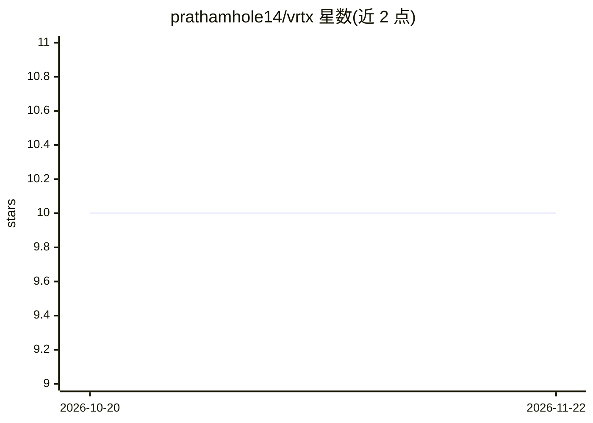

# prathamhole14/vrtx

⭐ 10 · Python · MIT · 推送 2026-09-08 · [GitHub](https://github.com/prathamhole14/vrtx) · [官网](https://prathamhole14.github.io/vrtx/) · 个人维护

**终端用户在 CLI 中与多家 LLM 对话并调试 shell 命令的工具**

基于 LangChain 构建的 Python CLI 工具，提供统一接口接入 Google Gemini、OpenAI、Anthropic Claude 多家模型，支持对话模式、会话历史管理与模型切换；Gemini 默认内置，OpenAI 与 Anthropic 作为可选 extras 按需安装。附加调试模式（beta）可分析最近的 shell 命令定位问题。通过 pip/conda 安装，模型在 JSON 配置文件中选择，要求 Python 3.10+。

## 筛选速览

| 维度 | 判定 | 备注 |
|---|---|---|
| AI 角色 | `ai-native` | 本体是模型或模型工具 |
| 许可风险 | `permissive` | MIT |
| 部署形态 | `library` | 以包/库形式分发 |
| 模型依赖 | locked-api |  |
| 硬件要求 | — | 无带数字的原话,不猜 |
| 安装摩擦 | `low` | 无编译、无系统依赖或容器化 |
| 成熟度 | — | 结构信号不足 |

## 能力要点

- 统一接口接入 Gemini/OpenAI/Claude 多家 LLM
- OpenAI/Anthropic 作为可选 extras，按需下载包
- shell 命令调试模式，可指定分析最近 n 条命令
- JSON 配置文件管理模型选择与切换

## 适用场景

- 在终端直接向多个 LLM 提问或对话
- 排查最近执行失败的 shell 命令原因
- 在一家 CLI 里切换使用不同厂商的模型

## 场景标签

`聊天机器人` · 领域:对话与助手

## 证据(README 行号)

> L3: A modern CLI tool for interacting with multiple LLMs using LangChain.
> L51: vrtx "your question"                  # Ask a question

## 星数曲线

2026-10-20 10 → 2026-11-22 10（+0）

---
*卡片 v1 · prompt 1.4 · 生成 2026-11-19 · 置信度 high · 依据 README sha `705204755f61` · [字段定义](../../DATASET.md)*
