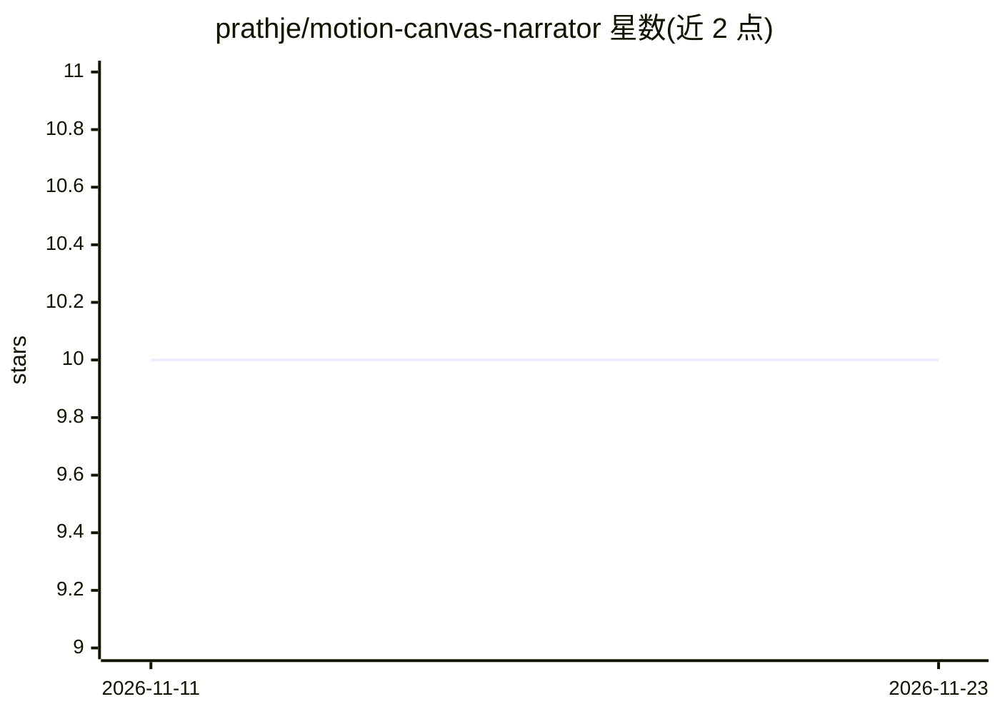

# prathje/motion-canvas-narrator

⭐ 10 · TypeScript · MIT · 推送 2026-09-26 · [GitHub](https://github.com/prathje/motion-canvas-narrator) · 个人维护

**为 Motion Canvas 动画项目提供代码定义的旁白与 AI 配音**

一个 Motion Canvas 插件包，把旁白（voiceover）定义为代码，使配音与字幕能随动画同步。工作流：在场景代码中调用 narrator.speak()，由所选 TTS provider 生成音频并按旁白时长生成动画帧；提供服务器端音频缓存插件（motion-canvas-cache）避免重复生成，以及无音频输出的 Mock Provider 用于脚本与字幕规划。当前处于早期开发阶段，支持 ElevenLabs TTS/音效、Minimax，Google Vertex AI 标记为 wip，也可从本地文件加载音频。

## 筛选速览

| 维度 | 判定 | 备注 |
|---|---|---|
| AI 角色 | `ai-native` | 本体是模型或模型工具 |
| 许可风险 | `permissive` | MIT |
| 部署形态 | `library` | 以包/库形式分发 |
| 模型依赖 | — | README 未给出锁定关系 |
| 硬件要求 | — | 无带数字的原话,不猜 |
| 安装摩擦 | `medium` | 含编译或系统依赖之一 |
| 成熟度 | `idea` | |

## 能力要点

- 在 Motion Canvas 代码中定义旁白并与动画系统同步（all 组合）
- AI 生成配音：ElevenLabs TTS/音效、Minimax，Google Vertex AI 为 wip
- 服务器端音频缓存插件避免重复生成
- Mock Provider 支持无音频的脚本与字幕规划

## 适用场景

- 为代码生成的动画视频添加同步的旁白配音
- 用 AI TTS 从文本生成解说音轨
- 录制前先用 Mock Provider 规划脚本和字幕时间线

## 场景标签

`语音合成` · 领域:内容生成

## 证据(README 行号)

> L16: - **AI Narration**: Use AI to generate voiceovers from text.
> L52: npm install motion-canvas-narrator
> L73: The narrator serves as the primary interface for generating audio from text.

## 星数曲线

2026-11-11 10 → 2026-11-23 10（+0）

---
*卡片 v1 · prompt 1.4 · 生成 2026-11-19 · 置信度 mid · 依据 README sha `d8f342dc7422` · [字段定义](../../DATASET.md)*
