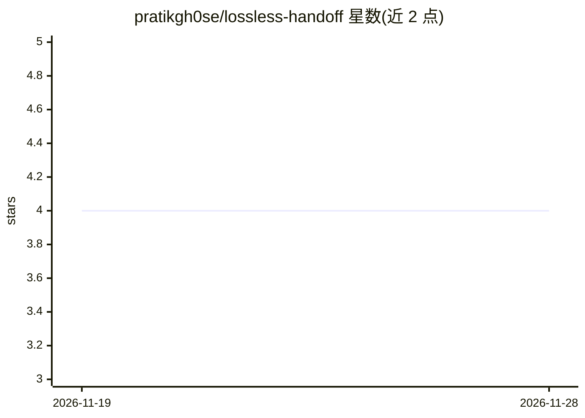

# pratikgh0se/lossless-handoff

⭐ 4 · Python · MIT · 推送 2026-11-27 · [GitHub](https://github.com/pratikgh0se/lossless-handoff) · 个人维护

**为 Claude Code 用户在自动压缩前保存无损上下文交接的 hooks**

一组 Claude Code hooks：在每次自动压缩（compaction）前写入结构化 handoff 并在新上下文中注入回传，同时维护每个项目的决策清单，提供 recall 工具以关键词加可选本地语义搜索找回此前对话的原文。由 PreCompact/SessionStart/PostToolUse 三个钩子组成，仅依赖 Python 3 标准库，支持 macOS 与 Linux，需已安装 Claude Code。基于 arXiv:2605.04050 论文，作者声明评估尚未完成且仅在自身机器验证。

## 筛选速览

| 维度 | 判定 | 备注 |
|---|---|---|
| AI 角色 | `ai-ecosystem` | LLM/agent 周边工具 |
| 许可风险 | `permissive` | MIT |
| 部署形态 | `None` |  |
| 模型依赖 | local-ok | 支持本地模型 |
| 硬件要求 | — | 无带数字的原话,不猜 |
| 安装摩擦 | `low` | 无编译、无系统依赖或容器化 |
| 成熟度 | `idea` | |

## 能力要点

- 压缩前写入结构化 handoff，压缩后自动注入新上下文
- 每项目决策清单在多次压缩后仍保留
- recall 工具以关键词搜索加可选本地语义搜索（bge-m3）找回原话
- 钩子始终 exit 0，不阻塞压缩，失败时仍写最小 handoff

## 适用场景

- 长时间 Claude Code 会话避免压缩后丢失下一步与上下文细节
- 跨会话记录并检索项目决策与批准原因
- 逐字找回此前对话中说过的原话

## 场景标签

`Agent 记忆` · 领域:Agent 开发

## 证据(README 行号)

> L17: Before each compaction, the hooks write a structured handoff and feed it back in. Each project keeps a decisions li
> L61: - **Nudge** (`handoff-nudge.py`, PostToolUse). At 75% of the auto-compact window, and again every 25,000 tokens, th
> L62: - **Handoff** (`precompact-handoff.py`, PreCompact). Just before compaction, the hook writes `<session_id>-latest.m

## 星数曲线

2026-11-19 4 → 2026-11-28 4（+0）

---
*卡片 v1 · prompt 1.4 · 生成 2026-11-21 · 置信度 high · 依据 README sha `5a6563a1463a` · [字段定义](../../DATASET.md)*
