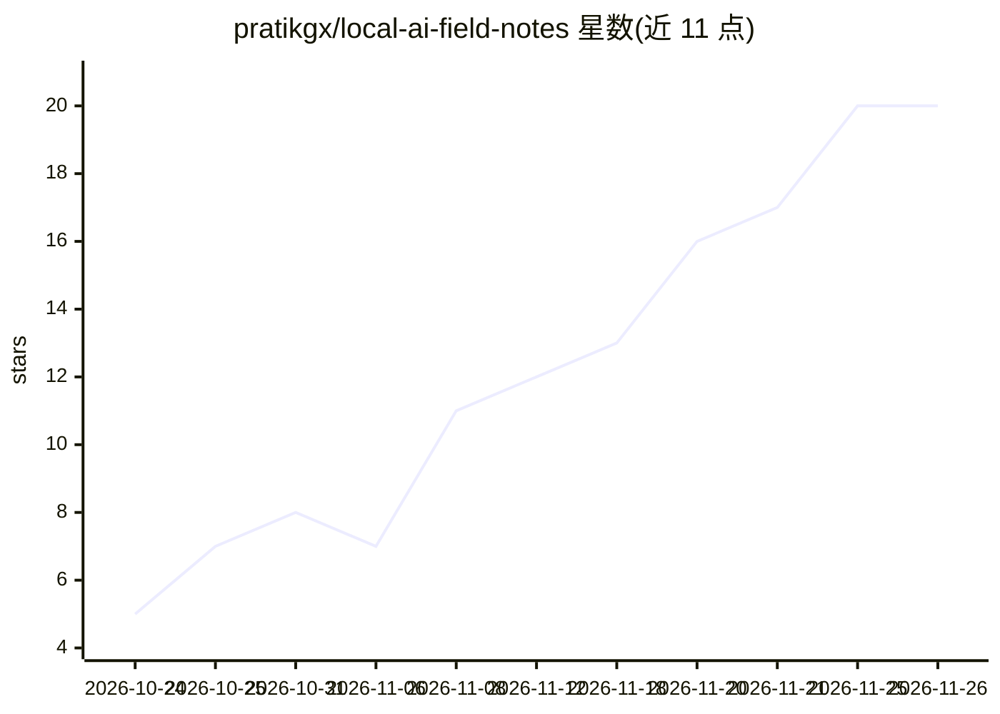

# pratikgx/local-ai-field-notes

⭐ 20 · Python · NOASSERTION · 推送 2026-11-25 · [GitHub](https://github.com/pratikgx/local-ai-field-notes) · 个人维护

**个人本地 AI 运行日志与基准脚本：给非工程师的笔记集**

作者记录在自己 Mac mini 上运行开放权重模型的笔记仓库：按日期记录尝试过程与故障（notes/）、追踪每个模型的内存占用与速度（models.md）、整理本地 AI 构建者名单（people.md、people.csv）、收录自建的 Hugging Face 模型与数据集清单，并附术语表。提供 bench.sh 脚本，可在 Apple Silicon Mac 上安装 mlx-lm、按内存挑选模型并记录速度与内存数据，结果写入 results/ 与 models.md，可通过 issue 分享对比结果。

## 筛选速览

| 维度 | 判定 | 备注 |
|---|---|---|
| AI 角色 | `ai-knowledge` | 知识聚合/清单类 |
| 许可风险 | `none` | NOASSERTION |
| 部署形态 | `None` |  |
| 模型依赖 | — | README 未给出锁定关系 |
| 硬件要求 | — | 无带数字的原话,不猜 |
| 安装摩擦 | `low` | 无编译、无系统依赖或容器化 |
| 成熟度 | — | 结构信号不足 |

## 能力要点

- bench.sh 脚本自动安装 mlx-lm、按内存筛选模型并记录速度与内存占用
- models.md 追踪已运行模型的内存与速度数据
- 本地 AI 构建者名单（people.md/people.csv）按技术栈分层整理
- huggingface.md 每日自动检查变更的自建模型/数据集清单

## 适用场景

- 在 Apple Silicon Mac 上复现相同的本地模型基准测试
- 了解本地 AI 生态中有哪些构建者可以关注
- 查找在自己内存配置下能运行的模型及其实测表现

## 场景标签

`模型评测` · 领域:评测与运维

## 证据(README 行号)

> L3: I'm learning to run AI on my own hardware, and I'm writing down what I find as I go.
> L11: - people.md lists the builders behind local AI, sorted by the part of the stack they work on, with handles you can 
> L24: `bash scripts/bench.sh` installs mlx-lm in a separate environment, picks models that fit your memory and logs speed

## 星数曲线

2026-10-24 5 → 2026-11-26 20（+15）

---
*卡片 v1 · prompt 1.4 · 生成 2026-11-18 · 置信度 high · 依据 README sha `862e14f864a1` · [字段定义](../../DATASET.md)*
