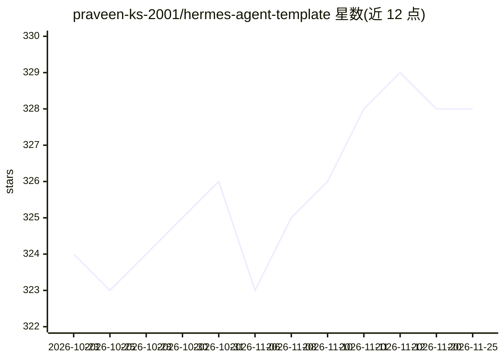

# praveen-ks-2001/hermes-agent-template

⭐ 328 · Python · 推送 2026-10-21 · [GitHub](https://github.com/praveen-ks-2001/hermes-agent-template) · [官网](https://railway.com/deploy/hermes-agent-ai?referralCode=QXdhdr) · 个人维护

**在 Railway 一键部署 Hermes Agent 的管理面板模板**

面向在 Railway 上部署 Hermes Agent 的用户，提供 Web 管理面板与部署模板：通过 /setup 向导选择 LLM provider、勾选消息渠道与工具、配置并启停 Hermes 网关，支持用户配对审批、日志流查看、备份/恢复，并将 Hermes 原生 UI（Chat、Keys、Skills、Kanban 等）代理在同一登录之后。容器内由 server.py 统一暴露唯一入口，托管并守护 Hermes 网关子进程；配置持久化于 /data 卷。模板在 Dockerfile 中固定 Hermes 版本，升级需使用对应 release 分支。

## 筛选速览

| 维度 | 判定 | 备注 |
|---|---|---|
| AI 角色 | `ai-ecosystem` | LLM/agent 周边工具 |
| 许可风险 | `none` | — |
| 部署形态 | `self-host` | docker 或自建部署 |
| 模型依赖 | local-ok | 支持本地模型 |
| 硬件要求 | — | 无带数字的原话,不猜 |
| 安装摩擦 | `low` | 无编译、无系统依赖或容器化 |
| 成熟度 | — | 结构信号不足 |

## 能力要点

- Setup 向导覆盖 provider/渠道/工具选择，无需编辑配置文件
- 网关浏览器端启停与崩溃自动重启（带退避）
- 用户配对审批与待审批请求列表
- 备份 zip 下载（6 小时有效）与恢复前自动安全快照

## 适用场景

- 一键在 Railway 上部署自己的 Hermes Agent 并接入 Telegram 等渠道
- 通过 Web 面板审批哪些用户可以和机器人对话
- 定期备份 Hermes 配置、凭证与聊天历史

## 场景标签

`聊天机器人` · 领域:对话与助手

## 证据(README 行号)

> L3: Deploy Hermes Agent on Railway with a web-based admin dashboard for configuration, gateway management, and user pair
> L15: - **Admin Dashboard** — dark-themed setup wizard at `/setup` to configure providers, channels, tools, and manage th
> L18: - **Gateway Management** — start, stop, restart the Hermes gateway from the browser, with automatic restart if it c

## 星数曲线

2026-10-23 324 → 2026-11-25 328（+4）

---
*卡片 v1 · prompt 1.4 · 生成 2026-11-25 · 置信度 high · 依据 README sha `702201596562` · [字段定义](../../DATASET.md)*
