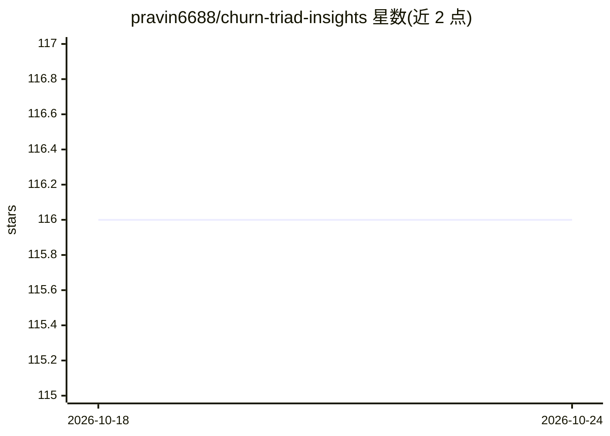

# pravin6688/churn-triad-insights

⭐ 116 · HTML · 推送 2026-10-23 · [GitHub](https://github.com/pravin6688/churn-triad-insights) · 个人维护

**LLM 驱动的客户流失风险分析工具：自然语言查询加风险解读**

面向订阅制业务（SaaS、电信、订阅媒体等）的客户流失分析系统：输入含客户标识、时间戳与行为指标的数据，经特征工程与 LLM 推理层生成流失风险评分及自然语言解读。支持自然语言查询数据、行为漂移监测、多语言摘要、阈值告警与 PDF/Markdown 报告导出，数据接入支持 CSV、JDBC/ODBC 与 Kafka/Kinesis 流连接。README 未提供具体安装命令或运行方式，下载章节为空。

## 筛选速览

| 维度 | 判定 | 备注 |
|---|---|---|
| AI 角色 | `ai-native` | 本体是模型或模型工具 |
| 许可风险 | `none` | — |
| 部署形态 | `None` |  |
| 模型依赖 | — | README 未给出锁定关系 |
| 硬件要求 | — | 无带数字的原话,不猜 |
| 安装摩擦 | `low` | 无编译、无系统依赖或容器化 |
| 成熟度 | — | 结构信号不足 |

## 能力要点

- 流失风险评分附 LLM 生成的自然语言解读
- 自然语言查询客户数据并返回结果与解释性摘要
- 支持 CSV、JDBC/ODBC、Kafka/Kinesis 数据接入
- PDF/Markdown 洞察报告导出与 RESTful API

## 适用场景

- 分析订阅业务客户流失风险并获取可读解释
- 用自然语言向客户数据提问获取分析结果
- 监测客户行为漂移并在风险升高时收到告警

## 场景标签

`数据分析` · 领域:效率与自动化

## 证据(README 行号)

> L3: # 🧠 Cognitive Churn Decoder — LLM-Powered Predictive Risk Intelligence
> L13: The Cognitive Churn Decoder operates on a deceptively simple principle: **structured data contains unstructured mea

## 星数曲线

2026-10-18 116 → 2026-10-24 116（+0）

---
*卡片 v1 · prompt 1.4 · 生成 2026-10-23 · 置信度 mid · 依据 README sha `aa3f5e5a8f08` · [字段定义](../../DATASET.md)*
