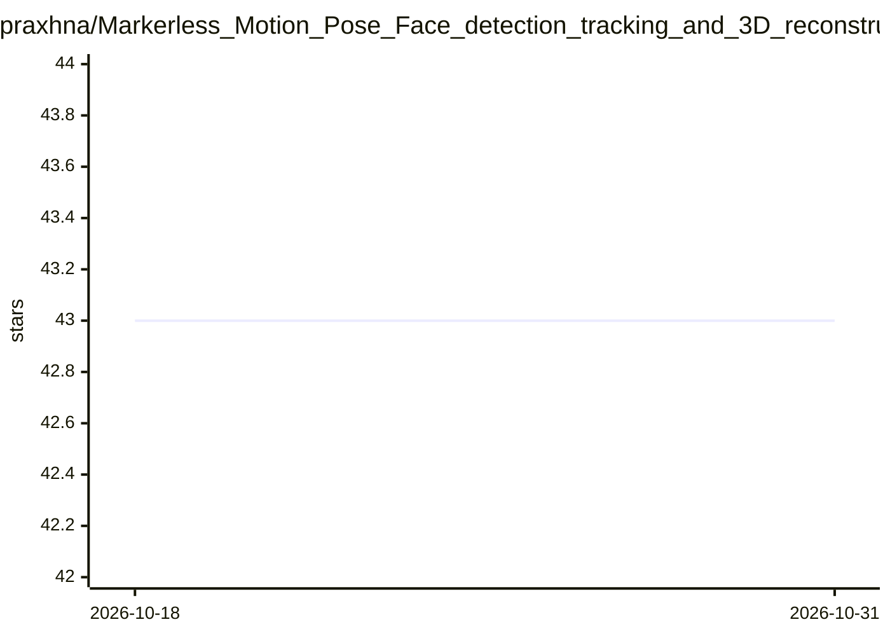

# praxhna/Markerless_Motion_Pose_Face_detection_tracking_and_3D_reconstruction

⭐ 43 · 推送 2025-11-23 · [GitHub](https://github.com/praxhna/Markerless_Motion_Pose_Face_detection_tracking_and_3D_reconstruction) · 个人维护

**无标记动作/姿态/人脸检测与3D重建项目，README 为学习资源清单**

仓库名称声明目标为无标记的动作/姿态/人脸检测、跟踪及实时 3D 重建，C++ 方向。README 主体并未给出实现或安装说明，而是收录 3D 重建、Structure from Motion、视觉计算相关课程、书籍、论文与开源库的链接清单，涵盖 OpenCV/Dlib 头部姿态估计教程、CGAL/VTK/PCL 等库介绍；末尾列出 3D 姿态估计、人体运动映射到 3D 模型等未来方向。面向视觉计算方向的学习者与开发者。

## 筛选速览

| 维度 | 判定 | 备注 |
|---|---|---|
| AI 角色 | `ai-knowledge` | 知识聚合/清单类 |
| 许可风险 | `none` | — |
| 部署形态 | `None` |  |
| 模型依赖 | — | README 未给出锁定关系 |
| 硬件要求 | — | 无带数字的原话,不猜 |
| 安装摩擦 | `medium` | 含编译或系统依赖之一 |
| 成熟度 | — | 结构信号不足 |

## 能力要点

- 主题声明覆盖检测、跟踪与实时 3D 重建
- 收录视觉计算课程/书籍/论文/数据集链接
- 列出 CGAL/VTK/PCL/OpenCV/Dlib 等库介绍
- 列出未来方向：3D 姿态估计与运动映射

## 适用场景

- 系统学习 3D 重建与计算机视觉的入门路径
- 查找 OpenCV/Dlib 头部姿态估计实践教程
- 了解视觉计算相关开源库与数据集

## 场景标签

`精选清单` · 领域:学习与行业

## 证据(README 行号)

> L24: ### Other tutorials and links :
> L33: ### Books and online courses on Visual Computing:
> L62: ### Noteworthy open source libraries for visual computing:

## 星数曲线

2026-10-18 43 → 2026-10-31 43（+0）

---
*卡片 v1 · prompt 1.4 · 生成 2026-10-25 · 置信度 mid · 依据 README sha `716b9d66599f` · [字段定义](../../DATASET.md)*
