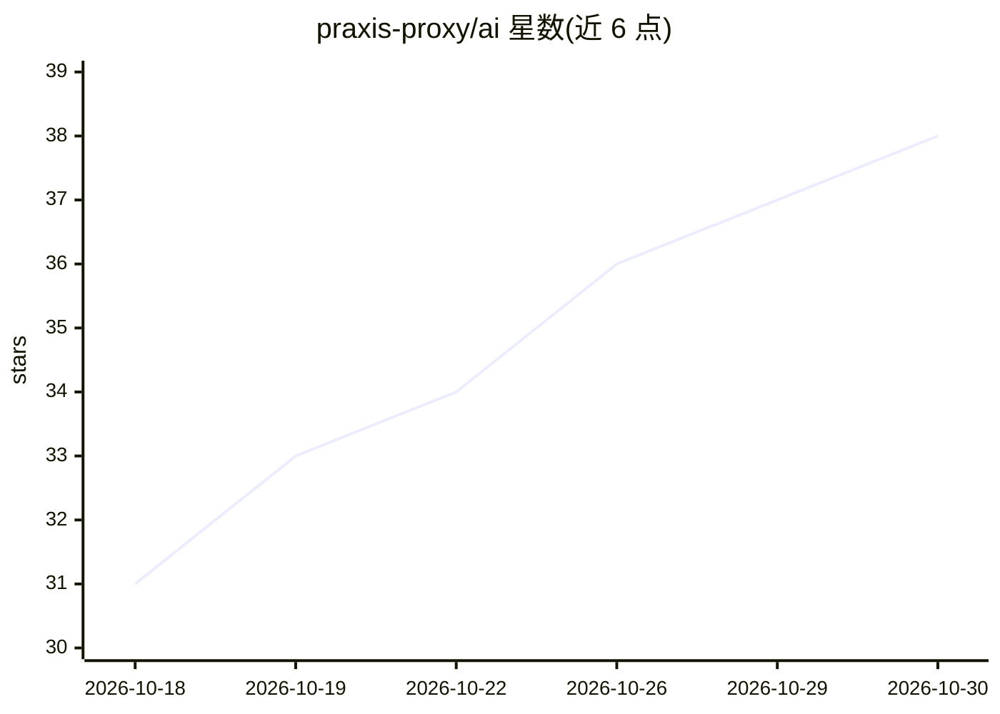

# praxis-proxy/ai

⭐ 38 · Rust · Apache-2.0 · 推送 2026-10-29 · [GitHub](https://github.com/praxis-proxy/ai) · 组织维护

**面向开发者的 AI 网关：路由、协议转换与策略代理**

基于 Praxis 代理运行时构建的 AI 网关：对 OpenAI Responses、Chat Completions、Anthropic Messages、MCP 与 A2A 流量进行分类、转换与路由，按 API 格式、模型或 MCP 工具名选择后端；可将流量适配到 Azure OpenAI、AWS Bedrock Converse、Vertex AI Gemini 等托管云格式。提供 OpenAI Responses 状态持久化（PostgreSQL/SQLite）、令牌限流与计量、外部 guardrails 调用，并支持用 Rust 自定义过滤器扩展。以 cargo 构建或 GHCR 容器镜像分发。当前为 alpha 软件，v1.0.0 前 API 与配置可能变动。

## 筛选速览

| 维度 | 判定 | 备注 |
|---|---|---|
| AI 角色 | `ai-ecosystem` | LLM/agent 周边工具 |
| 许可风险 | `permissive` | Apache-2.0 |
| 部署形态 | `self-host` | docker 或自建部署 |
| 模型依赖 | local-ok | 支持本地模型 |
| 硬件要求 | — | 无带数字的原话,不猜 |
| 安装摩擦 | `low` | 无编译、无系统依赖或容器化 |
| 成熟度 | `idea` | |

## 能力要点

- 按请求内容（API 格式/模型/MCP 工具名）路由与选择后端
- OpenAI/Anthropic/托管云（Azure、Bedrock、Vertex）协议翻译，含流式响应
- Responses 状态持久化与 Conversations 端点（PostgreSQL/SQLite）
- 令牌限流、计量、外部 guardrails 与自定义 Rust 过滤器扩展

## 适用场景

- 统一代理多家 LLM 提供商流量并按内容选择后端
- 让 Codex、Claude Code 等编码客户端接入 vLLM 等 Chat Completions 后端
- 对 AI 流量施加令牌限额、计量与外部 guardrails 策略

## 场景标签

`模型网关` · 领域:Agent 开发

## 证据(README 行号)

> L9: **Praxis AI is an AI gateway built on
> L63: Clients keep their provider-native protocols while Praxis AI classifies,

## 星数曲线

2026-10-18 31 → 2026-10-30 38（+7）

---
*卡片 v1 · prompt 1.4 · 生成 2026-10-25 · 置信度 high · 依据 README sha `71d468874fa6` · [字段定义](../../DATASET.md)*
