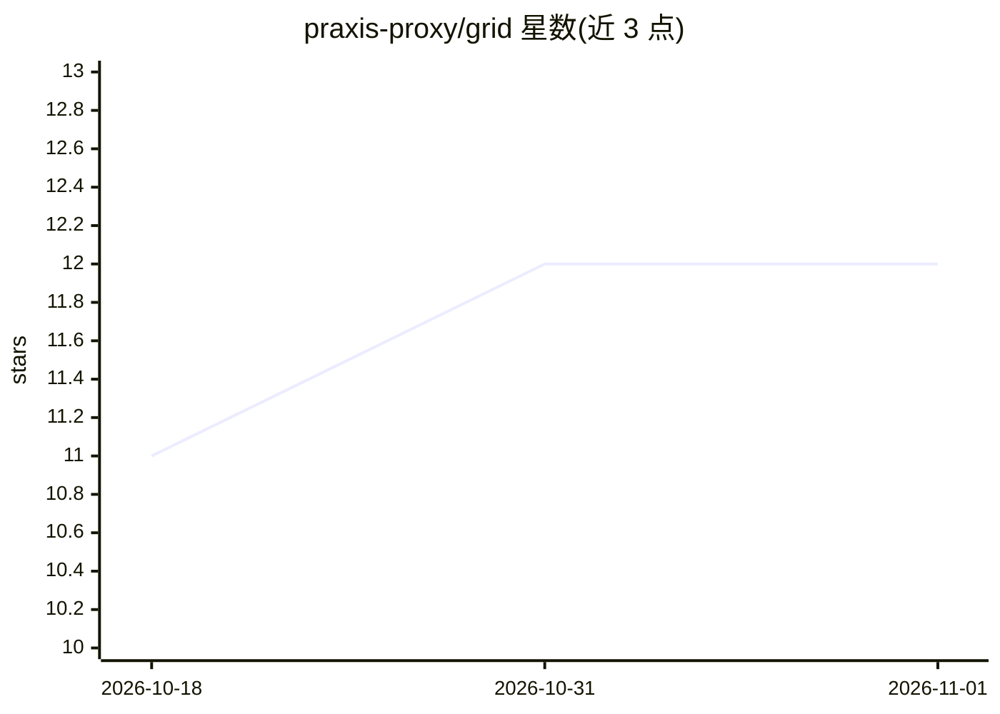

# praxis-proxy/grid

⭐ 12 · Rust · Apache-2.0 · 推送 2026-10-31 · [GitHub](https://github.com/praxis-proxy/grid) · 组织维护

**跨 Kubernetes 集群连接推理提供方的路由网络操作器**

AI Grid Network (AGN) 是一个 Rust 编写的 Kubernetes 操作器，跨集群、云服务与外部 API 发现并跟踪推理提供方，通过 SWIM 协议交换成员与提供方状态，并以 ConfigMap 形式向 Praxis AI 网关发布路由 overlay；网关基于本地快照为每个请求选择提供方。提供 GridNetwork/GridSite/InferenceProvider 等自定义资源，支持 noMetrics/queueDepth/kvCachePressure 三种评分策略。面向自建多站点推理路由的运维/开发者；项目处于 technical preview，不部署模型、不做迁移兼容承诺，用户需自备集群、后端、凭据与网关部署。

## 筛选速览

| 维度 | 判定 | 备注 |
|---|---|---|
| AI 角色 | `ai-ecosystem` | LLM/agent 周边工具 |
| 许可风险 | `permissive` | Apache-2.0 |
| 部署形态 | `None` |  |
| 模型依赖 | — | README 未给出锁定关系 |
| 硬件要求 | — | 无带数字的原话,不猜 |
| 安装摩擦 | `low` | 无编译、无系统依赖或容器化 |
| 成熟度 | `idea` | |

## 能力要点

- 操作器经 SWIM 与对端交换成员与提供方状态，不在请求路径上
- 以 ConfigMap overlay 发布路由状态，网关可在不重启情况下重载
- 三种提供方评分策略（noMetrics/queueDepth/kvCachePressure）
- 提供 Go API 类型模块与 Helm/Kustomize 部署方式

## 适用场景

- 跨多个 Kubernetes 集群组网并路由推理请求
- 为 Praxis AI 网关发布可热重载的路由 overlay
- 按队列深度或 KV 缓存压力选择提供方池

## 场景标签

`模型网关` · 领域:Agent 开发

## 证据(README 行号)

> L3: AI Grid Network (AGN) connects inference providers across Kubernetes clusters,
> L5: tracks provider availability, and publishes routing state for [Praxis AI]
> L15: provider state with peer operators over SWIM. For Praxis AI gateways, it

## 星数曲线

2026-10-18 11 → 2026-11-01 12（+1）

---
*卡片 v1 · prompt 1.4 · 生成 2026-11-01 · 置信度 high · 依据 README sha `345095079ee8` · [字段定义](../../DATASET.md)*
