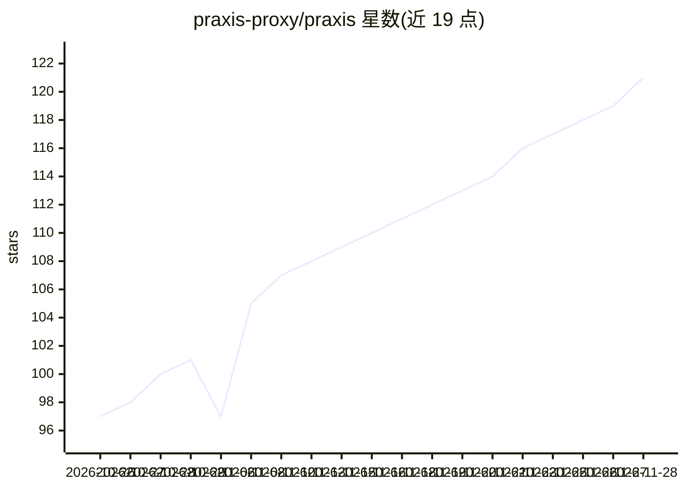

# praxis-proxy/praxis

⭐ 121 · Rust · Apache-2.0 · 推送 2026-11-27 · [GitHub](https://github.com/praxis-proxy/praxis) · [官网](https://praxis.fast) · 组织维护

**给开发者构建代理服务器的 Rust 框架**

Praxis 是一个基于 Rust 的代理服务器构建框架，提供配置、策略执行、过滤器、扩展、TLS 与安全加固等模块化能力；policy 过滤器内嵌 Praxis Policy Engine（PPE）用于访问控制、委托与数据保护。README 以文档导航为主，提供 Quickstart、源码构建与示例配置入口，测试覆盖声明 ≥97%，并有 OpenSSF 最佳实践与一致性认证徽章。与 AI 相关的功能不在本仓库，分离在 praxis-proxy/ai 仓库中。

## 筛选速览

| 维度 | 判定 | 备注 |
|---|---|---|
| AI 角色 | `ai-ecosystem` | LLM/agent 周边工具 |
| 许可风险 | `permissive` | Apache-2.0 |
| 部署形态 | `None` |  |
| 模型依赖 | — | README 未给出锁定关系 |
| 硬件要求 | — | 无带数字的原话,不猜 |
| 安装摩擦 | `low` | 无编译、无系统依赖或容器化 |
| 成熟度 | — | 结构信号不足 |

## 能力要点

- 基于 Rust 的代理服务器构建框架
- policy 过滤器内嵌 Praxis Policy Engine（PPE）实现访问控制与数据保护
- 提供 TLS、安全加固、过滤器与扩展等模块
- 测试覆盖率声明 ≥97%，MSRV 1.92

## 适用场景

- 构建 HTTP/网络代理服务
- 在代理层执行访问控制与数据保护策略
- 需要 TLS 与安全加固的网关场景

## 场景标签

 · 领域:网络基础设施/代理框架

## 证据(README 行号)

> L11: Praxis is a [Rust]-based framework for building **proxy servers**.
> L33: The `policy` filter embeds the [Praxis Policy Engine (PPE)][ppe] for access
> L36: AI features live in a separate repository: [praxis-proxy/ai].

## 星数曲线

2026-10-26 97 → 2026-11-28 121（+24）

---
*卡片 v1 · prompt 1.4 · 生成 2026-11-28 · 置信度 mid · 依据 README sha `921d80b1fb07` · [字段定义](../../DATASET.md)*
