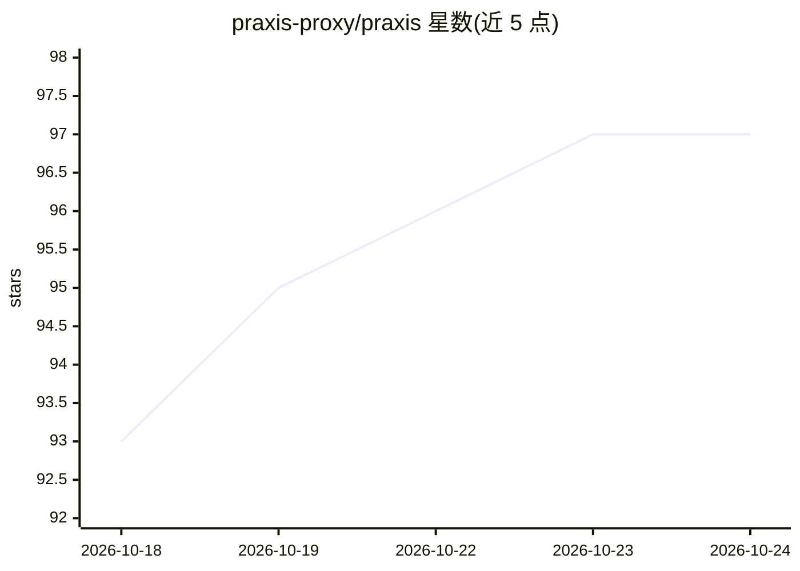

# praxis-proxy/praxis

⭐ 97 · Rust · Apache-2.0 · 推送 2026-10-23 · [GitHub](https://github.com/praxis-proxy/praxis) · [官网](https://praxis.fast) · 组织维护

**Rust 编写的代理服务器构建框架**

基于 Rust 的 proxy server 构建框架，提供配置、特性、过滤器、扩展、TLS 与安全加固等文档模块，测试覆盖率声明 ≥96%，MSRV 为 1.92，以 Apache-2.0 许可发布。README 明确指出 AI 相关功能在独立仓库 praxis-proxy/ai 中开发维护，本仓库不含 AI 源码。面向需要构建代理服务器的开发者。

## 筛选速览

| 维度 | 判定 | 备注 |
|---|---|---|
| AI 角色 | `ai-enhanced` | 去掉 AI 部分产品仍成立 |
| 许可风险 | `permissive` | Apache-2.0 |
| 部署形态 | `None` |  |
| 模型依赖 | — | README 未给出锁定关系 |
| 硬件要求 | — | 无带数字的原话,不猜 |
| 安装摩擦 | `low` | 无编译、无系统依赖或容器化 |
| 成熟度 | — | 结构信号不足 |

## 能力要点

- Rust 语言的代理服务器框架
- 覆盖配置、过滤器、扩展、TLS、安全加固等模块
- 声明测试覆盖率 ≥96%，MSRV 1.92

## 适用场景

- 用 Rust 构建自定义代理服务器
- 通过过滤器与扩展机制定制流量处理

## 场景标签

 · 领域:网络基础设施

## 证据(README 行号)

> L11: Praxis is a [Rust]-based framework for building **proxy servers**.
> L33: > **Note**: AI Features are developed and maintained in a separate repository.

## 星数曲线

2026-10-18 93 → 2026-10-24 97（+4）

---
*卡片 v1 · prompt 1.4 · 生成 2026-10-23 · 置信度 low · 依据 README sha `d8fb828235ba` · [字段定义](../../DATASET.md)*
