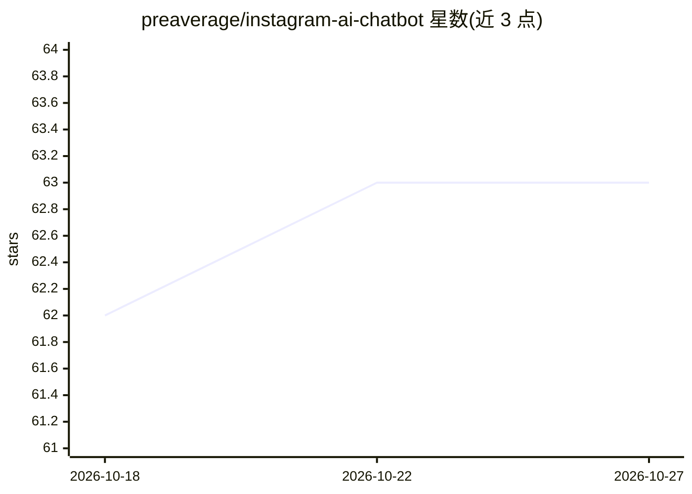

# preaverage/instagram-ai-chatbot

⭐ 63 · TypeScript · MIT · 推送 2026-02-11 · [GitHub](https://github.com/preaverage/instagram-ai-chatbot) · 个人维护

**用 ChatGPT 自动回复 Instagram 私信的拟人机器人**

基于 Node.js 的 Instagram 私信自动回复机器人：通过 instagram-private-api 与 instagram_mqtt 实时监听消息线程，将收到的消息连同发送者用户名交给 ChatGPT 生成回复，系统提示词在 config.json 中配置（可定义人设、语气、回复长度等规则），可限定仅监听特定线程并设置回复等待时间。需要 Instagram 账号凭据与 OpenAI API key。多人群聊处理、对话持久化、随机分享帖子等功能仍在 Todo 列表中。

## 筛选速览

| 维度 | 判定 | 备注 |
|---|---|---|
| AI 角色 | `ai-native` | 本体是模型或模型工具 |
| 许可风险 | `permissive` | MIT |
| 部署形态 | `library` | 以包/库形式分发 |
| 模型依赖 | — | README 未给出锁定关系 |
| 硬件要求 | — | 无带数字的原话,不猜 |
| 安装摩擦 | `low` | 无编译、无系统依赖或容器化 |
| 成熟度 | — | 结构信号不足 |

## 能力要点

- 实时监听并自动回复 Instagram 消息线程
- 人设与回复风格通过 config.json 系统提示词自定义
- 可限定只监听特定 threads 并设置 waitTime 延迟

## 适用场景

- 让 AI 用指定人设自动回复 Instagram 私信
- 限定特定会话线程进行自动应答

## 场景标签

`聊天机器人` · 领域:对话与助手

## 证据(README 行号)

> L3: An Instagram bot focused on acting human, powered by ChatGPT, instagram-private-api, and instagram_mqtt.
> L53: - [x] Automatically respond to messages with ChatGPT.

## 星数曲线

2026-10-18 62 → 2026-10-27 63（+1）

---
*卡片 v1 · prompt 1.4 · 生成 2026-10-24 · 置信度 high · 依据 README sha `10215b153acc` · [字段定义](../../DATASET.md)*
