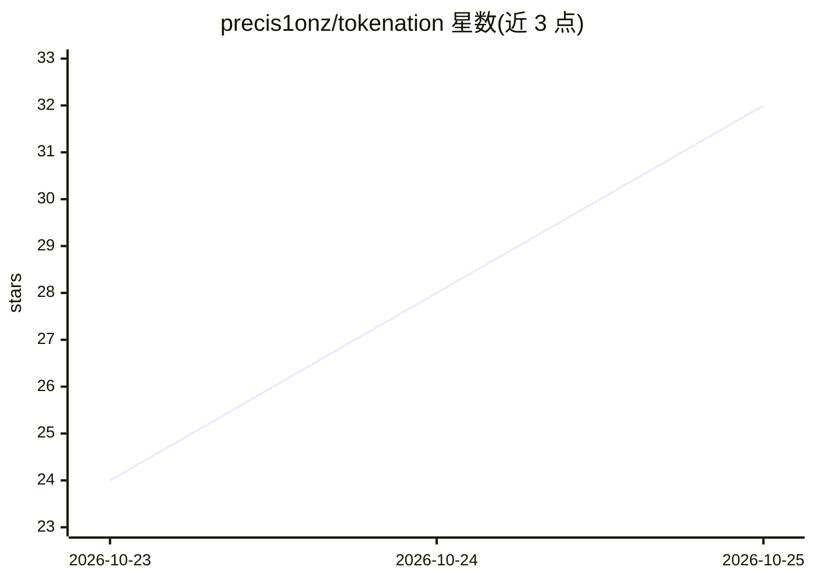

# precis1onz/tokenation

⭐ 34 · MIT · 推送 2026-10-24 · [GitHub](https://github.com/precis1onz/tokenation) · 个人维护 · 中文 README

**免费 LLM API 羊毛清单：85 条评分条目，日更逐条核实**

收录各平台免费 LLM API 额度的双语清单，条目分常态免费与限时免费两类，每行记录平台、模型 ID、简介、免费额度、截止日与推荐指数。指数按智能（Artificial Analysis 指数）占 40% + 免费额度占 60% 计算，每日回到厂商官方页面核实，过期条目移除。覆盖 85 条已评分条目，提供中英文版本及 Top 15 榜。不评分返回类型化结果的决策模型、路由端点和总参数低于 20B 的模型。

## 筛选速览

| 维度 | 判定 | 备注 |
|---|---|---|
| AI 角色 | `ai-knowledge` | 知识聚合/清单类 |
| 许可风险 | `permissive` | MIT |
| 部署形态 | `None` |  |
| 模型依赖 | — | README 未给出锁定关系 |
| 硬件要求 | — | 无带数字的原话,不猜 |
| 安装摩擦 | `low` | 无编译、无系统依赖或容器化 |
| 成熟度 | — | 结构信号不足 |

## 能力要点

- 85 条已评分条目，分常态免费与限时免费双清单
- 0-100 评分：智能 40% + 免费额度 60%
- 每日逐条回官方页面核实，过期条目移除
- 中英双语版本

## 适用场景

- 找当前可白嫖的 LLM API 额度并比较其价值
- 查看限时免费 offer 的截止日期避免错过
- 为个人项目挑选零成本推理来源

## 场景标签

`精选清单` · 领域:学习与行业

## 证据(README 行号)

> L7: Tokenation collects free LLM API offers and checks every entry against the provider's own pages. Offers are split in
> L45: - Every score traces back to the provider's own page, rechecked daily.
> L87: 上表从 85 行已评分条目中取前 15 行，评分口径见下节。完整清单见下方四个列表。

## 星数曲线

2026-10-23 24 → 2026-10-25 32（+8）

---
*卡片 v1 · prompt 1.4 · 生成 2026-10-25 · 置信度 high · 依据 README sha `b44aa0f87e32` · [字段定义](../../DATASET.md)*
