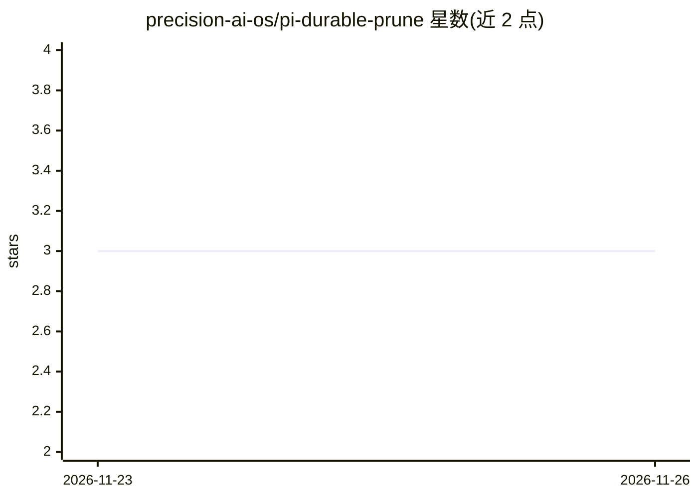

# precision-ai-os/pi-durable-prune

⭐ 3 · TypeScript · MIT · 推送 2026-11-20 · [GitHub](https://github.com/precision-ai-os/pi-durable-prune) · [官网](https://getprecision.ai) · 组织维护

**为 pi-durable agent 提供上下文裁剪与召回工具的库**

面向基于 pi-durable 构建的应用的 npm 库：将较早的大体积工具结果在模型读取的上下文中替换为简短说明，并提供 recall_tool 让模型按 ref 读回原文，原始记录保留在 transcript 中不改动。通过空闲时一次性写入、不重写说明、保留最近一轮完整三项规则保持 provider 前缀缓存有效。策略字段含 minChars、keepAsks、keep、note；错误结果与非文本结果始终保留。附带 686 条聊天回放的节省比例测量与已知限制说明。

## 筛选速览

| 维度 | 判定 | 备注 |
|---|---|---|
| AI 角色 | `ai-ecosystem` | LLM/agent 周边工具 |
| 许可风险 | `permissive` | MIT |
| 部署形态 | `library` | 以包/库形式分发 |
| 模型依赖 | — | README 未给出锁定关系 |
| 硬件要求 | — | 无带数字的原话,不猜 |
| 安装摩擦 | `low` | 无编译、无系统依赖或容器化 |
| 成熟度 | — | 结构信号不足 |

## 能力要点

- 工具结果替换为短说明 + recallTool 按 ref 读回原文
- 三项规则维护 provider prompt cache 前缀命中
- 可配置策略：minChars/keepAsks/keep/note，note 必须确定性
- 多会话共享时可用 visible 限制召回可见范围

## 适用场景

- 长对话 agent 中削减每轮重发的陈旧工具结果
- 需要保持 prompt cache 生效的 pi-durable 应用
- 多人共享会话时限制各自可召回的工具结果

## 场景标签

`Agent 记忆` · 领域:Agent 开发

## 证据(README 行号)

> L3: Context pruning for pi-durable agents.
> L5: > A library for apps built on pi-durable, used from your own code. It is not a Pi coding-agent extension: `pi instal

## 星数曲线

2026-11-23 3 → 2026-11-26 3（+0）

---
*卡片 v1 · prompt 1.4 · 生成 2026-11-23 · 置信度 high · 依据 README sha `c3418f478327` · [字段定义](../../DATASET.md)*
