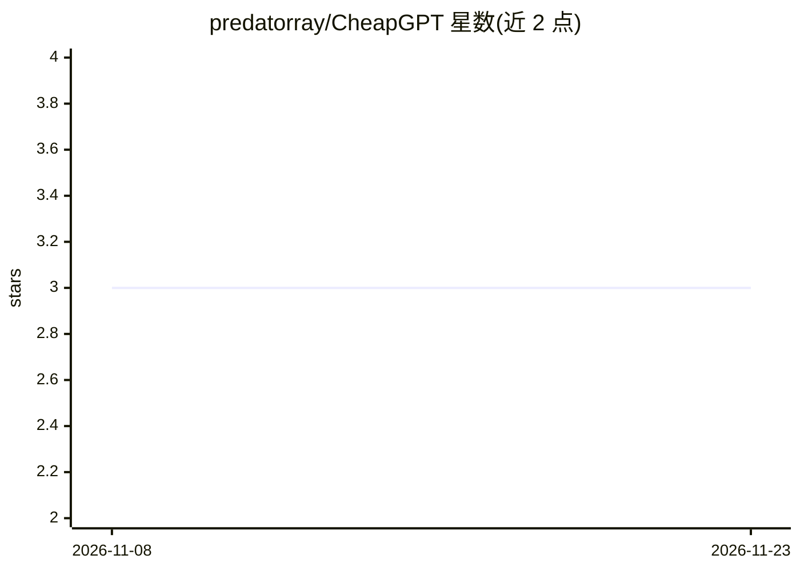

# predatorray/CheapGPT

⭐ 3 · TypeScript · MIT · 推送 2026-11-05 · [GitHub](https://github.com/predatorray/CheapGPT) · [官网](http://www.predatorray.me/CheapGPT/) · 个人维护 · 中文 README

**基于浏览器本地模型的免费 ChatGPT 风格聊天应用**

纯前端聊天应用，调用浏览器内置 Prompt API 的本地模型完成推理，无远程 AI API、API key、后端与账户。本地模型选择并串联工具调用：算术、时区、网页搜索、百科、仓库、天气、IP、汇率查询，以及 JavaScript 沙箱执行。会话历史与记忆保存在浏览器 localStorage，公共查询仅发送查询词。限制：本地模型仅支持英语、推理能力有限、上下文有界、需合格浏览器与 HTTPS/localhost，首次模型下载数 GB。

## 筛选速览

| 维度 | 判定 | 备注 |
|---|---|---|
| AI 角色 | `ai-native` | 本体是模型或模型工具 |
| 许可风险 | `permissive` | MIT |
| 部署形态 | `library` | 以包/库形式分发 |
| 模型依赖 | — | README 未给出锁定关系 |
| 硬件要求 | — | 无带数字的原话,不猜 |
| 安装摩擦 | `low` | 无编译、无系统依赖或容器化 |
| 成熟度 | — | 结构信号不足 |

## 能力要点

- 浏览器 on-device 模型推理，无 API key、后端与账户
- 本地模型自动选择并串联至多 6 次经验证的工�具调用
- JavaScript 沙箱本地执行，带执行与内存限制
- 会话历史与记忆存于浏览器本地，隐私表说明各功能外发内容

## 适用场景

- 本地起草邮件、总结会议笔记
- 无需付费或注册即可使用带工具调用的聊天助手
- 在共享设备上关闭持久化以保留对话隐私
- 在浏览器内完成汇率换算、CSV 排序等轻量任务

## 场景标签

`聊天机器人` `AI 助手` · 领域:对话与助手

## 证据(README 行号)

> L8:  Powered by your browser’s on-device model. No AI bill included.
> L28: CheapGPT pairs the browser’s `LanguageModel` (Prompt) API with a handful of useful tools. Draft an email, work thro
> L30: No remote AI API, API keys, application backend, accounts, or subscription. A small model can still make big mistak

## 星数曲线

2026-11-08 3 → 2026-11-23 3（+0）

---
*卡片 v1 · prompt 1.4 · 生成 2026-11-21 · 置信度 high · 依据 README sha `8359f5d5d16a` · [字段定义](../../DATASET.md)*
