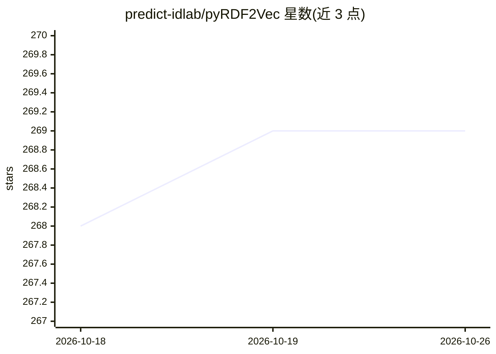

# predict-idlab/pyRDF2Vec

⭐ 269 · Python · MIT · 推送 2026-10-09 · [GitHub](https://github.com/predict-idlab/pyRDF2Vec) · [官网](https://pyrdf2vec.readthedocs.io/en/latest/) · 组织维护

**知识图谱实体嵌入生成库（RDF2Vec 的 Python 实现与扩展）**

RDF2Vec 论文算法的 Python 实现与扩展：在知识图谱上按可配置的游走策略（如 RandomWalker）与采样策略（如 PageRankSampler）提取随机游走序列，再经 Word2Vec（CBOW/Skip-Gram）训练生成实体的 2D 特征矩阵，供下游机器学习任务使用。知识图谱可从 SPARQL 端点、RDFLib 读取文件或从零构建三种方式初始化。支持 n_jobs 多进程、SPARQL 请求捆绑与缓存以加速游走提取，并提示大量并发请求可能触发端点服务器 DOS 防护。面向做知识图谱表示学习的研究者与开发者。

## 筛选速览

| 维度 | 判定 | 备注 |
|---|---|---|
| AI 角色 | `ai-native` | 本体是模型或模型工具 |
| 许可风险 | `permissive` | MIT |
| 部署形态 | `library` | 以包/库形式分发 |
| 模型依赖 | — | README 未给出锁定关系 |
| 硬件要求 | — | 无带数字的原话,不猜 |
| 安装摩擦 | `low` | 无编译、无系统依赖或容器化 |
| 成熟度 | — | 结构信号不足 |

## 能力要点

- 游走策略 + 采样策略 + Word2Vec 生成实体嵌入
- KG 三种初始化方式：SPARQL 端点 / RDFLib 文件 / 从零构建
- n_jobs 多进程与 SPARQL 请求捆绑、缓存加速游走提取
- 同时返回嵌入向量与实体 literal 信息

## 适用场景

- 为知识图谱中的实体生成嵌入用于下游分类等 ML 任务
- 从 DBpedia 等 SPARQL 端点或本地 RDF 文件提取实体表示
- 复现与扩展 RDF2Vec 论文实验

## 场景标签

`知识图谱` · 领域:知识与检索

## 证据(README 行号)

> L33:  Python implementation and extension of <a
> L56: This repository contains an implementation of the algorithm in "RDF2Vec:
> L111:  embeddings, literals = transformer.fit_transform(knowledge_graph, entities)

## 星数曲线

2026-10-18 268 → 2026-10-26 269（+1）

---
*卡片 v1 · prompt 1.4 · 生成 2026-10-22 · 置信度 high · 依据 README sha `223f27e72541` · [字段定义](../../DATASET.md)*
