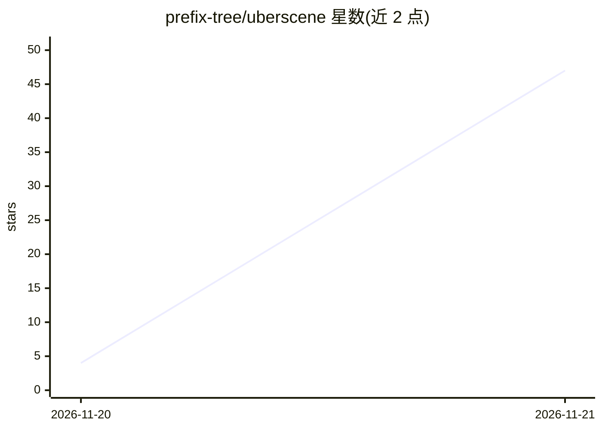

# prefix-tree/uberscene

⭐ 47 · TypeScript · MIT · 推送 2026-11-20 · [GitHub](https://github.com/prefix-tree/uberscene) · [官网](http://uberscene.prefixtree.xyz/) · 个人维护

**面向 agent 的代码化视频编辑 React 库：TSX 即视频**

UberScene 是一个 React 库，将一个 TSX 文件作为视频本身：片段、字幕、音频、转场、特效以及叠加的 React/Motion/three.js 层都写在该文件中。可在浏览器播放、在时间线上调整并导出 MP4。关键机制是剪辑以转写词或镜头命名（如 in="word:12"）而非秒数，由库计算具体帧；agent 编辑文本与人在时间线编辑写回同一文件并支持撤销。需 Node 22.19 以上，MIT 许可。

## 筛选速览

| 维度 | 判定 | 备注 |
|---|---|---|
| AI 角色 | `ai-enhanced` | 去掉 AI 部分产品仍成立 |
| 许可风险 | `permissive` | MIT |
| 部署形态 | `library` | 以包/库形式分发 |
| 模型依赖 | — | README 未给出锁定关系 |
| 硬件要求 | — | 无带数字的原话,不猜 |
| 安装摩擦 | `medium` | 含编译或系统依赖之一 |
| 成熟度 | — | 结构信号不足 |

## 能力要点

- TSX 单文件即视频，可 diff、PR 评审、批量生成变体
- 剪辑以转写词或镜头命名，库负责帧级计算
- agent 文本编辑与时间线编辑写回同一源文件
- 官方提供 Claude Code 插件及其他 agent 的 skills 安装方式

## 适用场景

- 让 AI agent 从长视频按语义剪出竖屏短片并加字幕
- 以代码方式管理视频项目并做版本评审
- 用同一文件驱动剪辑与 three.js 3D 场景预览

## 场景标签

`视频生成` · 领域:内容生成

## 证据(README 行号)

> L5:  A React library for making videos and building editors around them.
> L60: Then give your agent the skill that lets it make and edit videos. In Claude Code:
> L67: For any other agent: `npx uberscene skills install`. Then brief it like an editor: *"Cut a 30 second vertical clip

## 星数曲线

2026-11-20 4 → 2026-11-21 47（+43）

---
*卡片 v1 · prompt 1.4 · 生成 2026-11-21 · 置信度 mid · 依据 README sha `36c52ab91152` · [字段定义](../../DATASET.md)*
