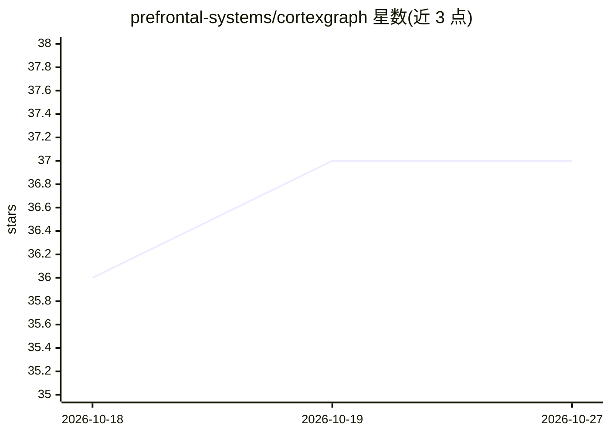

# prefrontal-systems/cortexgraph

⭐ 37 · HTML · AGPL-3.0 · 推送 2026-10-26 · [GitHub](https://github.com/prefrontal-systems/cortexgraph) · 组织维护

**为 AI 助手提供类人遗忘曲线的时序记忆 MCP 服务器**

Model Context Protocol (MCP) 服务器，为 Claude 等 AI 助手提供短期/长期两层记忆系统：记忆按 Ebbinghaus 遗忘曲线随时间衰减，使用即强化，达到阈值（如 14 天内使用 5 次）后晋升为长期记忆。数据全部本地存储：短期用 JSONL 或 SQLite，长期用 Obsidian 兼容的 Markdown；提供知识图谱、自然语言自动保存/召回（spaCy NER 实体抽取）与五 agent 记忆整理管线。项目自称研究产物（PoC），不建议生产使用。前身为 mnemex，已迁移并更名。

## 筛选速览

| 维度 | 判定 | 备注 |
|---|---|---|
| AI 角色 | `ai-ecosystem` | LLM/agent 周边工具 |
| 许可风险 | `viral` | AGPL-3.0 |
| 部署形态 | `library` | 以包/库形式分发 |
| 模型依赖 | — | README 未给出锁定关系 |
| 硬件要求 | — | 无带数字的原话,不猜 |
| 安装摩擦 | `low` | 无编译、无系统依赖或容器化 |
| 成熟度 | `idea` | |

## 能力要点

- 时间衰减评分算法：综合近因性、使用频率与重要度强度
- 两层架构：JSONL/SQLite 短期记忆 + Obsidian Markdown 长期记忆
- 自然语言自动保存/召回/强化，无需显式命令
- 五 agent 整理管线（衰减分析、聚类、语义合并、LTM 晋升、关系发现）

## 适用场景

- 让 Claude 等 MCP 客户端跨会话记住我的偏好和决定
- 在 Obsidian 中永久保存高频使用的重要记忆
- 研究认知架构式的 AI 记忆衰减与强化机制

## 场景标签

`Agent 记忆` `知识图谱` · 领域:Agent 开发

## 证据(README 行号)

> L3: A Model Context Protocol (MCP) server providing **human-like memory dynamics** for AI assistants. Memories naturally
> L36: **CortexGraph gives AI assistants like Claude a human-like memory system.**

## 星数曲线

2026-10-18 36 → 2026-10-27 37（+1）

---
*卡片 v1 · prompt 1.4 · 生成 2026-10-25 · 置信度 high · 依据 README sha `8b92dfd4b9a9` · [字段定义](../../DATASET.md)*
