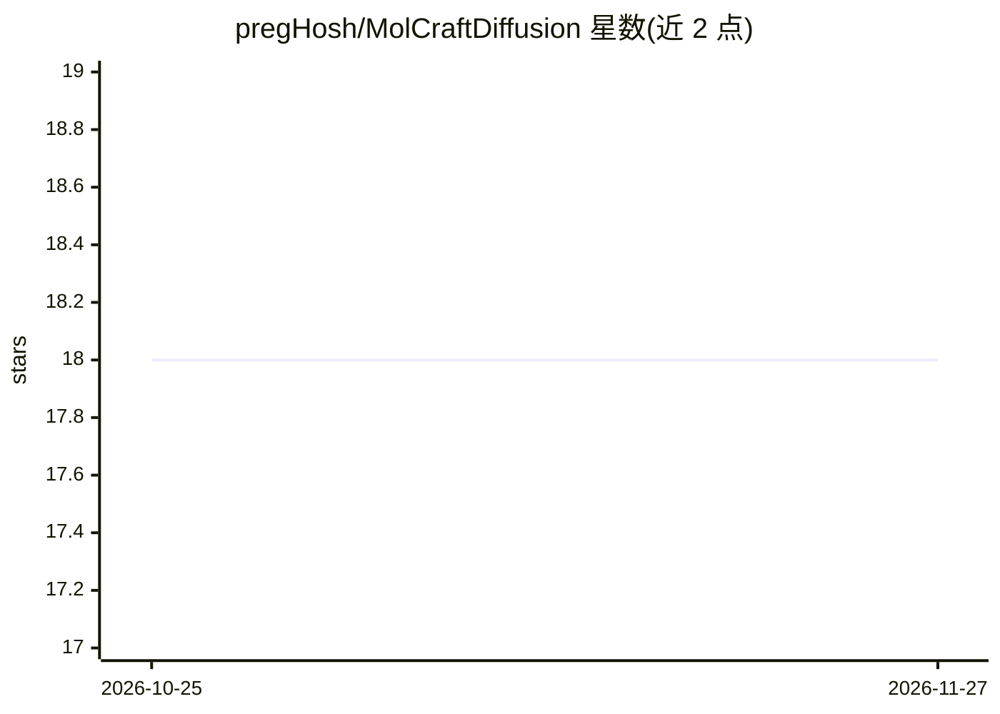

# pregHosh/MolCraftDiffusion

⭐ 18 · Python · MIT · 推送 2026-11-15 · [GitHub](https://github.com/pregHosh/MolCraftDiffusion) · [官网](https://pregHosh.github.io/MolCraftDiffusion/) · 个人维护

**面向计算化学的 3D 分子生成统一框架：训练/生成/评测一体化**

将多种 3D 分子生成范式（de novo、性质导向、结构引导、形状/口袋/药效团条件化、片段连接、隐空间扩散与流匹配）聚合到统一的模块化架构与 CLI（train·generate·predict·analyze·data）之下，覆盖数据准备、训练微调、引导生成、checkpoint 管理与后处理分析（含分子对接、量子化学描述符）。预训练权重与数据集托管于 Hugging Face（需 token 访问）与 Zenodo。附带 12 个教程与无代码 Web UI AutomaticMolCraft。主要面向计算化学与药物设计研究人员，配有平台论文与 DOI。

## 筛选速览

| 维度 | 判定 | 备注 |
|---|---|---|
| AI 角色 | `ai-native` | 本体是模型或模型工具 |
| 许可风险 | `permissive` | MIT |
| 部署形态 | `library` | 以包/库形式分发 |
| 模型依赖 | — | README 未给出锁定关系 |
| 硬件要求 | — | 无带数字的原话,不猜 |
| 安装摩擦 | `medium` | 含编译或系统依赖之一 |
| 成熟度 | — | 结构信号不足 |

## 能力要点

- 统一 CLI 与配置系统整合多种 3D 生成范式
- 模型动物园按名称解析权重与数据，sha256 校验
- 内置分析套件：几何优化、有效性指标、对接（dock/bias）、MM-GBSA
- 新增生成器只需子包即插（模型实现+任务适配器+Hydra 配置）

## 适用场景

- 做 de novo 或性质导向的 3D 分子生成实验
- 在同一管线内比较不同生成范式
- 结构导向的药物设计与虚拟库构建
- 不写代码通过 Web UI 做条件化生成

## 场景标签

`模型训练` `模型评测` · 领域:评测与运维

## 证据(README 行号)

> L13: **One platform brings together a broad range of 3D molecular generators for de novo, property-directed, structure-g
> L21: - **De novo generation** of complete 3D molecules
> L41: |**Unified CLI**|`train · generate · predict · analyze · data`, all from one `MolCraftDiff` entry point|

## 星数曲线

2026-10-25 18 → 2026-11-27 18（+0）

---
*卡片 v1 · prompt 1.4 · 生成 2026-11-18 · 置信度 high · 依据 README sha `2e974f9439ff` · [字段定义](../../DATASET.md)*
