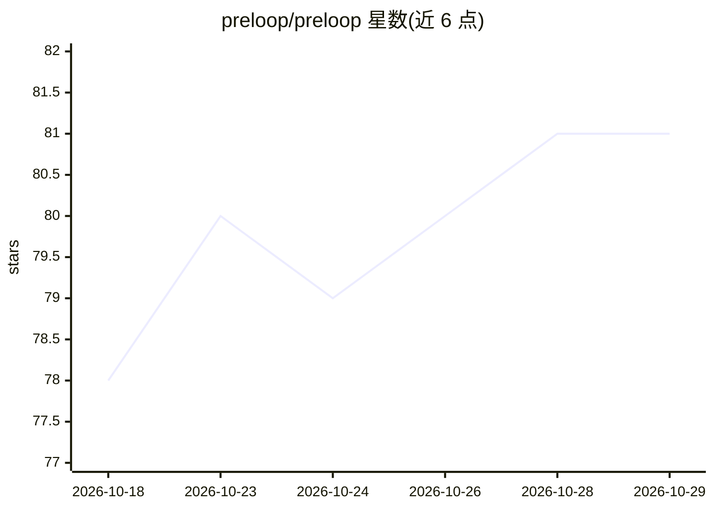

# preloop/preloop

⭐ 81 · Python · Apache-2.0 · 推送 2026-10-28 · [GitHub](https://github.com/preloop/preloop) · [官网](https://preloop.ai) · 组织维护

**自托管 AI agent 控制平面与软件工厂：治理每次工具与模型调用**

单一自托管服务，部署在 AI agent 与其可达资源之间：MCP 防火墙对每次工具调用允许/拒绝/转人工审批，模型网关按模型、agent、会话、API key 记账并设预算，策略以 YAML+CEL 代码化；另一侧软件工厂在 GitHub/GitLab/Jira 等事件触发时于托管容器或私有 runner 上运行 agent，附 20 个预设（PR 审查、issue 实现、安全审计等）。面向平台/安全团队与运行编码 agent 的工程团队。Apache 2.0 开源版单操作员每账户，RBAC、多审批人路由等组织层属商业版（Cloud/Enterprise）。Docker Compose 与 Helm 为受支持安装面。

## 筛选速览

| 维度 | 判定 | 备注 |
|---|---|---|
| AI 角色 | `ai-ecosystem` | LLM/agent 周边工具 |
| 许可风险 | `permissive` | Apache-2.0 |
| 部署形态 | `self-host` | docker 或自建部署 |
| 模型依赖 | locked-api |  |
| 硬件要求 | — | 无带数字的原话,不猜 |
| 安装摩擦 | `low` | 无编译、无系统依赖或容器化 |
| 成熟度 | — | 结构信号不足 |

## 能力要点

- MCP 防火墙：允许/拒绝/需审批的工具调用治理，策略为 YAML+CEL
- AI 模型网关：多 provider 兼容，按维度记账、设预算与归因
- 事件驱动的 Flow：容器或私有 runner 运行 agent，产出可审查的 PR
- 移动端/手表/Slack 人工审批与会话时间线观测

## 适用场景

- 在 agent 接入生产系统前统一治理其工具与模型调用
- 追踪各 agent/模型/API key 的网关开销并设预算上限
- 让 GitHub/Jira 事件自动触发编码 agent 完成 issue 实现与 PR 审查
- 为 CRA/欧盟 AI Act 类工作收集机器证据包

## 场景标签

`模型网关` `LLM 可观测性` `工作流自动化` · 领域:Agent 开发

## 证据(README 行号)

> L13: Preloop is one self-hostable service that sits between your AI agents and everything they reach, and runs agents fo
> L17: - **Control plane.** An MCP firewall that allows, denies or holds any tool call for human approval; an AI model gat

## 星数曲线

2026-10-18 78 → 2026-10-29 81（+3）

---
*卡片 v1 · prompt 1.4 · 生成 2026-10-24 · 置信度 mid · 依据 README sha `db1757eb2987` · [字段定义](../../DATASET.md)*
