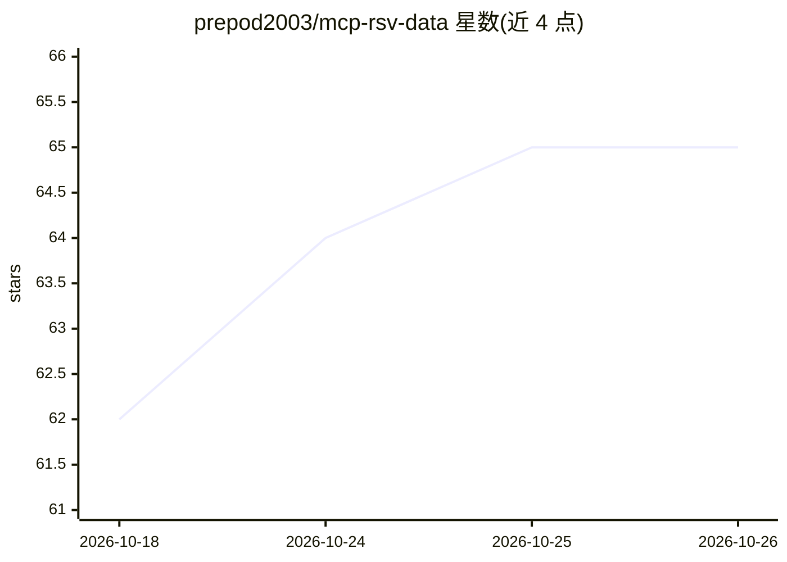

# prepod2003/mcp-rsv-data

⭐ 65 · Go · MIT · 推送 2026-09-07 · [GitHub](https://github.com/prepod2003/mcp-rsv-data) · [官网](https://prepod2003.github.io/rsv-data-pro/) · 个人维护

**免费 MCP 服务器：让 AI 代理用自然语言只读访问 1C 数据库与元数据**

以 1C:Enterprise 扩展形式实现的 MCP 服务器，向 Claude、Cursor 等 AI 客户端开放工作数据库：会计与分析师可用自然语言查询库存、客户、销售等数据，无需掌握 1C 查询语言；开发者可获得任意配置的表/字段/类型元数据结构作为上下文。仅只读，遵守用户权限并自动匿名化个人数据。通过 HTTP 服务或 Windows 上的 COM 桥接程序 rsvdata-bridge.exe 两种方式连接；存在同产品线的付费版 MCP:RSV Data Pro 与 MCP:RSV Server。

## 筛选速览

| 维度 | 判定 | 备注 |
|---|---|---|
| AI 角色 | `ai-ecosystem` | LLM/agent 周边工具 |
| 许可风险 | `permissive` | MIT |
| 部署形态 | `desktop` | 安装包/桌面程序 |
| 模型依赖 | — | README 未给出锁定关系 |
| 硬件要求 | — | 无带数字的原话,不猜 |
| 安装摩擦 | `low` | 无编译、无系统依赖或容器化 |
| 成熟度 | — | 结构信号不足 |

## 能力要点

- 自然语言读取 1C 数据，仅只读、遵守用户权限、自动匿名化个人数据
- 导出任意配置的元数据结构（表/字段/类型）供开发者与 AI 代理使用
- 两种接入方式：HTTP 服务直连或 Windows COM 本地桥（rsvdata-bridge.exe）
- 7 个 MCP 工具：config/describe/get_structure/query/execute_query/ping/help

## 适用场景

- 会计和分析师通过 Claude/Cursor 用自然语言查询 1C 库存、销售数据
- 开发者获取 1C 配置元数据结构，避免 AI 代理编造表名字段名
- 给 AI 编程助手提供 1C 数据库上下文

## 场景标签

`数据分析` · 领域:效率与自动化

## 证据(README 行号)

> L7: **Бесплатный MCP-сервер для рабочей базы 1С:Предприятие** — два направления в одном расширении:
> L9: - **Данные базы — простым языком, без языка запросов 1С.** ИИ-агент (Claude, Cursor и др.) по обычной
> L48: 2. **Подключить ИИ-клиент** — двумя способами:

## 星数曲线

2026-10-18 62 → 2026-10-26 65（+3）

---
*卡片 v1 · prompt 1.4 · 生成 2026-10-24 · 置信度 high · 依据 README sha `f7f2b91cff22` · [字段定义](../../DATASET.md)*
