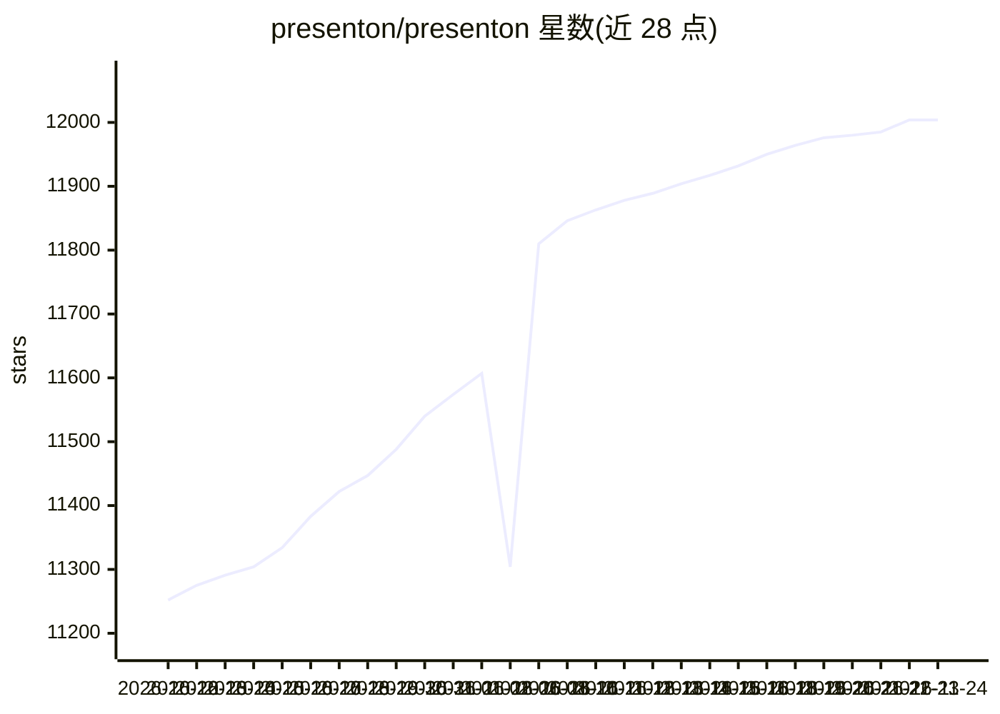

# presenton/presenton

⭐ 12,037 · TypeScript · Apache-2.0 · 推送 2026-11-23 · [GitHub](https://github.com/presenton/presenton) · [官网](https://presenton.ai) · 组织维护

**自托管 AI 演示文稿生成器与 API，产出可编辑 PPTX/PDF**

Presenton 是开源（Apache 2.0）的 AI 演示文稿生成工具，支持从提示词或上传文档生成幻灯片，可拖拽编辑并导出可编辑的 PPTX/PDF。运行方式包括 Docker 单命令部署、Electron 桌面应用（macOS/Windows/Linux）及云托管；提供 HTTP 生成 API、内置 MCP Server、多用户工作区与内置管理面板。支持自带 API Key 接入多家模型服务，也可用 Ollama 本地运行模型；另提供带 Helm Chart、SSO（OAuth/OIDC/SCIM）的 Enterprise 版本。

## 筛选速览

| 维度 | 判定 | 备注 |
|---|---|---|
| AI 角色 | `ai-native` | 本体是模型或模型工具 |
| 许可风险 | `permissive` | Apache-2.0 |
| 部署形态 | `desktop` | 安装包/桌面程序 |
| 模型依赖 | local-ok | 支持本地模型 |
| 硬件要求 | — | 无带数字的原话,不猜 |
| 安装摩擦 | `low` | 无编译、无系统依赖或容器化 |
| 成熟度 | — | 结构信号不足 |

## 能力要点

- 从提示词、文档或自定义 PowerPoint 设计生成完全可编辑的 PPTX/PDF
- 接入 Ollama、OpenAI、Gemini、Azure OpenAI、Anthropic 等 OpenAI 兼容服务，支持 BYOK
- 内置 MCP Server，可通过 Model Context Protocol 生成演示文稿
- Docker 一命令部署，Electron 桌面应用支持三大平台

## 适用场景

- 自托管环境里用自有模型生成商务/教育演示文稿
- 为团队托管演示生成 API 服务并管理多用户工作区
- 通过 MCP 让 agent 调用演示文稿生成能力

## 场景标签

`AI 写作` · 领域:内容生成

## 证据(README 行号)

> L15: # Open-Source AI Presentation Generator and API (Gamma, Canva, Beautiful AI, Decktopus, Presentations AI Alternativ
> L29: - Works with Ollama, LM Studio, OpenAI, Gemini, Vertex AI, Azure OpenAI, Amazon Bedrock, Fireworks, Together AI, An
> L44: Create presentations from a prompt, an uploaded document, or your own PowerPoint design. Choose from built-in templ

## 星数曲线

2026-10-22 11,252 → 2026-11-24 12,004（+752）

---
*卡片 v1 · prompt 1.4 · 生成 2026-11-23 · 置信度 high · 依据 README sha `f7cb989bcd01` · [字段定义](../../DATASET.md)*
