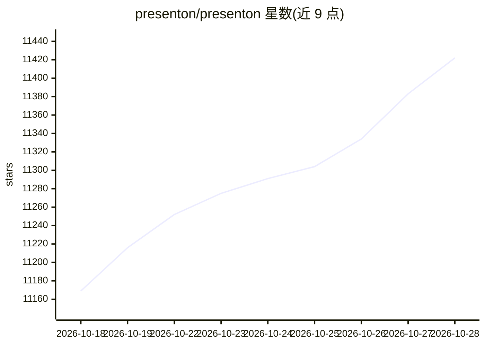

# presenton/presenton

⭐ 11,422 · TypeScript · Apache-2.0 · 推送 2026-10-27 · [GitHub](https://github.com/presenton/presenton) · [官网](https://presenton.ai) · 组织维护

**开源 AI 演示文稿生成器与 API，自托管生成 PPTX**

自托管的 AI 演示文稿生成应用：从提示词、上传文档或自有 PowerPoint 设计生成演示文稿，提供内置模板、拖拽编辑界面，导出完全可编辑的 PPTX 或 PDF。支持自备 API key 接入 OpenAI、Gemini、Vertex AI、Azure OpenAI、Anthropic 等多种模型提供方，或经 Ollama 本地运行开源模型。提供 Docker 一键部署、Electron 桌面应用（Mac/Windows/Linux）以及可供团队调用的 AI Presentation Generation API，内置 MCP Server 与多用户工作区管理。Apache 2.0 许可，另提供云端与 Enterprise（Helm/K8s、SSO）版本。

## 筛选速览

| 维度 | 判定 | 备注 |
|---|---|---|
| AI 角色 | `ai-native` | 本体是模型或模型工具 |
| 许可风险 | `permissive` | Apache-2.0 |
| 部署形态 | `desktop` | 安装包/桌面程序 |
| 模型依赖 | local-ok | 支持本地模型 |
| 硬件要求 | — | 无带数字的原话,不猜 |
| 安装摩擦 | `low` | 无编译、无系统依赖或容器化 |
| 成熟度 | — | 结构信号不足 |

## 能力要点

- 从提示词或文档生成演示文稿，导出完全可编辑的 PPTX/PDF
- BYOK 多提供方接入：OpenAI/Gemini/Vertex/Azure/Anthropic 或任意 OpenAI 兼容端点
- Ollama 集成实现本地开源模型运行，全流程本地处理
- Docker 一键部署（含 GPU 配置）与 Mac/Windows/Linux 桌面应用
- 内置 MCP Server 与多用户工作区/管理面板

## 适用场景

- 输入提示词或上传文档快速生成可编辑的演示文稿
- 在自有基础设施上部署 AI 演示生成能力并经 API 供团队调用
- 用自有 API key 或本地 Ollama 模型生成幻灯片，数据不出本机
- 复用公司自有 PowerPoint 模板生成符合品牌规范的演示文稿

## 场景标签

`AI 写作` · 领域:内容生成

## 证据(README 行号)

> L15: # Open-Source AI Presentation Generator and API (Gamma, Canva, Beautiful AI, Decktopus, Presentations AI Alternativ
> L30: - Comes with AI Presentation Generation API
> L44: Create presentations from a prompt, an uploaded document, or your own PowerPoint design. Choose from built-in templ

## 星数曲线

2026-10-18 11,169 → 2026-10-28 11,422（+253）

---
*卡片 v1 · prompt 1.4 · 生成 2026-10-20 · 置信度 high · 依据 README sha `e5c14f0ac7bd` · [字段定义](../../DATASET.md)*
