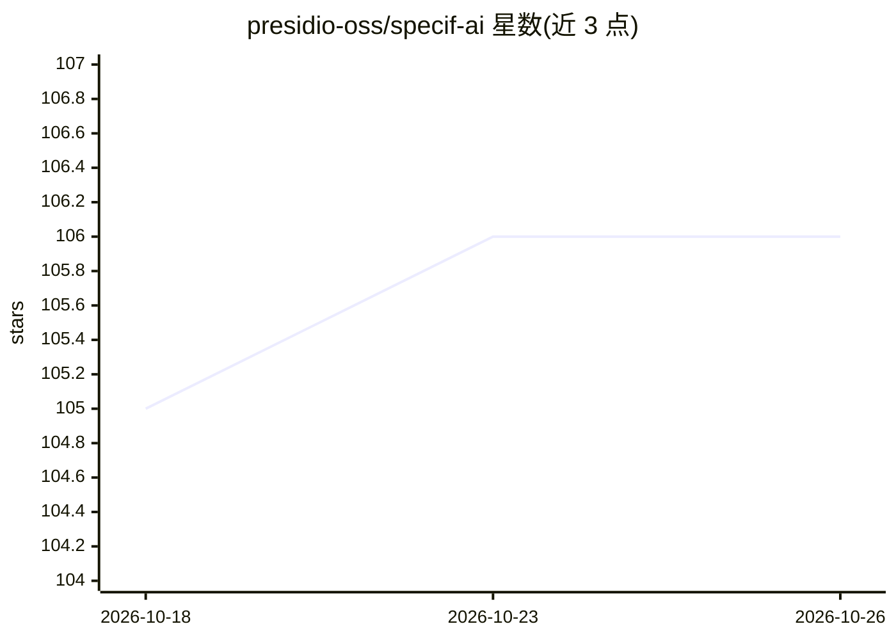

# presidio-oss/specif-ai

⭐ 106 · TypeScript · NOASSERTION · 推送 2026-06-03 · [GitHub](https://github.com/presidio-oss/specif-ai) · [官网](https://specifai.io/) · 组织维护

**把项目构想转为结构化需求文档与任务的 AI 桌面应用**

面向软件团队的 Electron 桌面应用：输入方案名称、描述与技术栈，自动生成 BRD/PRD/NFRD/UIR 等文档，并提供 AI 聊天改写、行内 AI 编辑、用户故事与任务生成、自动化测试用例生成、业务流程可视化与战略倡议管理。采用 LangGraph 框架实现多阶段 agentic 工作流，支持 Azure OpenAI、AWS Bedrock、Gemini、Anthropic、OpenRouter、Ollama 等多模型选择，可集成 Jira、Azure DevOps 与 MCP 工具。从 releases 页下载安装包或克隆源码运行。

## 筛选速览

| 维度 | 判定 | 备注 |
|---|---|---|
| AI 角色 | `ai-native` | 本体是模型或模型工具 |
| 许可风险 | `none` | NOASSERTION |
| 部署形态 | `desktop` | 安装包/桌面程序 |
| 模型依赖 | local-ok | 支持本地模型 |
| 硬件要求 | — | 无带数字的原话,不猜 |
| 安装摩擦 | `low` | 无编译、无系统依赖或容器化 |
| 成熟度 | — | 结构信号不足 |

## 能力要点

- 自动生成 BRD/PRD/NFRD/UIR 文档
- 基于 LangGraph 的多阶段 agentic 需求生成工作流
- 多模型支持（Azure OpenAI、AWS Bedrock、Gemini、Anthropic、OpenRouter、Ollama）
- Jira / Azure DevOps 集成与自定义 MCP 服务器扩展

## 适用场景

- 从构想快速产出结构化需求文档供团队评审
- 将需求转为用户故事、任务并同步到 Jira 或 Azure DevOps
- 借助企业知识库（如 AWS Bedrock KB）迭代完善需求

## 场景标签

`AI 写作` `代码生成` · 领域:编码与开发

## 证据(README 行号)

> L23: By simply providing a solution name, description, and tech stack details, Specifai automatically generates comprehe
> L52: - **🤖 AI-Powered Document Generation**: Effortlessly create detailed SDLC documentation.
> L146: Specif AI utilises the Langgraph framework to deliver an efficient agentic workflow, enhancing the creation of sol

## 星数曲线

2026-10-18 105 → 2026-10-26 106（+1）

---
*卡片 v1 · prompt 1.4 · 生成 2026-10-23 · 置信度 high · 依据 README sha `8b4317481e44` · [字段定义](../../DATASET.md)*
