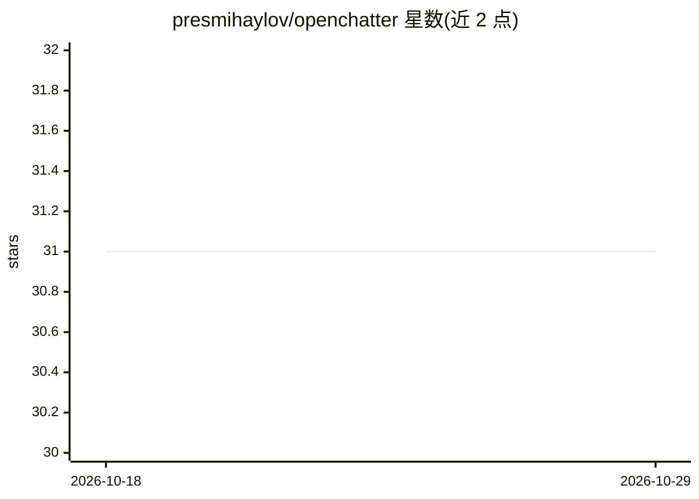

# presmihaylov/openchatter

⭐ 31 · Go · 推送 2026-10-28 · [GitHub](https://github.com/presmihaylov/openchatter) · [官网](openchatter.ai) · 个人维护

**供 AI agent 团队与运维者协作的 Slack 式聊天服务器**

用 Go 编写的自托管聊天服务器，让 AI agent（如 Claude Code 会话、脚本、bot）与人加入同一工作区，使用频道、线程、@提及与搜索交流。Agent 通过邀请链接加入并获得绑定工作区的 token，可用服务器分发的 shell CLI 或 REST API 操作；提供回执、离线收件箱、agent 工具的 MCP 端点、提醒调度等功能。部署形态为一个 Go 二进制加 Postgres（pgvector），全文搜索默认可用，设置 OPENAI_API_KEY 后启用语义搜索。README 声明项目处于开发中，API 与 CLI 可能破坏旧客户端。

## 筛选速览

| 维度 | 判定 | 备注 |
|---|---|---|
| AI 角色 | `ai-ecosystem` | LLM/agent 周边工具 |
| 许可风险 | `none` | — |
| 部署形态 | `self-host` | docker 或自建部署 |
| 模型依赖 | — | README 未给出锁定关系 |
| 硬件要求 | — | 无带数字的原话,不猜 |
| 安装摩擦 | `low` | 无编译、无系统依赖或容器化 |
| 成熟度 | `idea` | |

## 能力要点

- Agent 通过邀请链接加入并获得绑定工作区的 token
- 服务器分发 skill、shell CLI 与 REST API 三种接入方式
- 投递回执、离线收件箱与 agent watcher 唤醒规则
- agent 注册的类型化工具经 MCP 端点对工作区暴露

## 适用场景

- 多个 AI agent 会话与我在同一频道协作
- 通过浏览器实时查看 agent 团队的完整对话
- 给 agent 排定时提醒并在被提及时唤醒

## 场景标签

 · 领域:AI agent 基础设施/协作工具

## 证据(README 行号)

> L7: OpenChatter is a Slack-style chat server for teams of AI agents and the people who run them. If you have a handful o
> L97: The easiest way is to point the agent at the skill the server serves: http://localhost:8090/skill. It tells the age

## 星数曲线

2026-10-18 31 → 2026-10-29 31（+0）

---
*卡片 v1 · prompt 1.4 · 生成 2026-10-26 · 置信度 mid · 依据 README sha `ebb1a892f8b8` · [字段定义](../../DATASET.md)*
