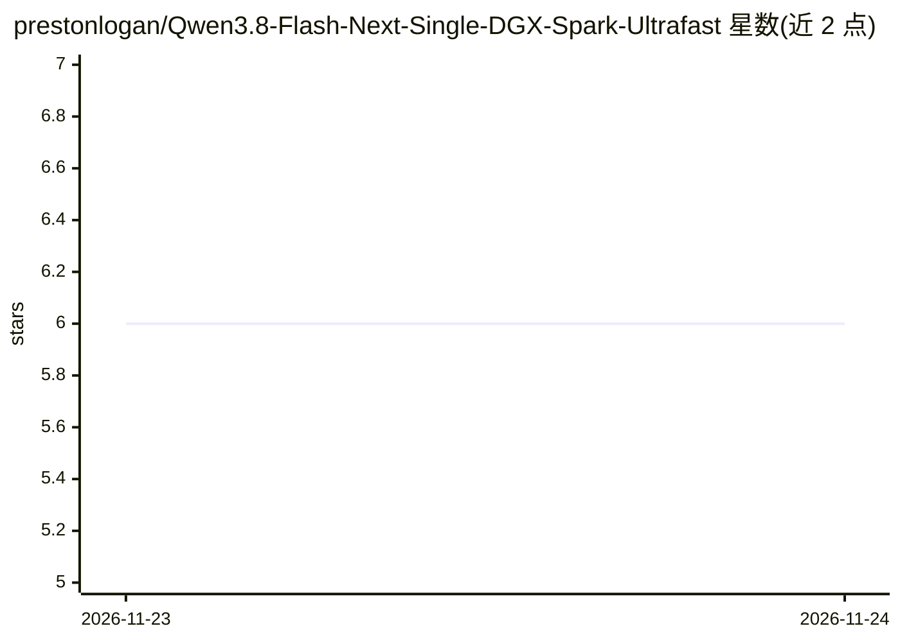

# prestonlogan/Qwen3.8-Flash-Next-Single-DGX-Spark-Ultrafast

⭐ 6 · HTML · MIT · 推送 2026-11-22 · [GitHub](https://github.com/prestonlogan/Qwen3.8-Flash-Next-Single-DGX-Spark-Ultrafast) · 个人维护

**在单台 DGX Spark 上以 100+ tok/s 服务 Qwen3.8-Flash-Next 的部署配方**

基于 dedene 的 Hibana Docker 配方改进的本地推理部署方案：在单台 NVIDIA DGX Spark（GB10）上以 Hibana 引擎的 fast 档位（3-bit 量化专家 + FP8 主干 + MTP 投机解码）运行 Qwen3.8-Flash-Next，并新增两个补丁启用图像输入与图像请求的投机解码。通过 Docker Compose 一键启动，在 8888 端口提供 OpenAI 与 Anthropic 兼容 API，支持思考模式、工具调用与流式输出。限制：fast 档位输出略有损、仅支持单卡、不支持视频、非英文文本需关闭草稿词表。

## 筛选速览

| 维度 | 判定 | 备注 |
|---|---|---|
| AI 角色 | `ai-ecosystem` | LLM/agent 周边工具 |
| 许可风险 | `permissive` | MIT |
| 部署形态 | `self-host` | docker 或自建部署 |
| 模型依赖 | — | README 未给出锁定关系 |
| 硬件要求 | — | 无带数字的原话,不猜 |
| 安装摩擦 | `low` | 无编译、无系统依赖或容器化 |
| 成熟度 | — | 结构信号不足 |

## 能力要点

- Hibana fast 档位：3-bit 专家副本 + FP8 主干 + MTP 投机解码，英文 prose 101.3 tok/s
- 两个自研补丁为 Flash-Next 添加图像输入（M-RoPE 多模态位置编码）与图像请求的 CUDA graphs
- OpenAI 与 Anthropic 兼容 API，支持思考开关、工具调用与流式输出
- Docker Compose 一键部署，环境变量可配置档位、草稿词表、并发数与上下文长度

## 适用场景

- 在 DGX Spark 本地部署多模态 LLM 并通过 API 给应用调用
- 本地运行带图像输入的代理编码任务（DeepSeek Harness 场景）
- 按吞吐或精度需求在 fast/exact 档位间切换部署

## 场景标签

`推理引擎` · 领域:训练与推理

## 证据(README 行号)

> L9: and adds **image input** for Flash-Next, which upstream Hibana does not load. OpenAI- and Anthropic-compatible API o
> L64: docker compose up -d --wait   # first run: ~15 min image build, 186 GB download, ~3 min kernel builds

## 星数曲线

2026-11-23 6 → 2026-11-24 6（+0）

---
*卡片 v1 · prompt 1.4 · 生成 2026-11-23 · 置信度 high · 依据 README sha `0dac0e3473bc` · [字段定义](../../DATASET.md)*
