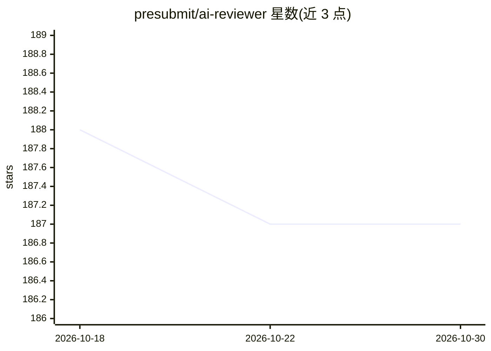

# presubmit/ai-reviewer

⭐ 187 · TypeScript · MIT · 推送 2026-09-14 · [GitHub](https://github.com/presubmit/ai-reviewer) · [官网](http://presubmit.ai) · 组织维护

**面向 Pull Request 的 AI 代码审查 GitHub Action**

以 GitHub Action 形式部署的 PR 审查工具：在人工审查前对 PR 做逐行分析，检测 bug、安全漏洞、反模式与性能问题，自动生成 PR 标题、描述与变更摘要，并可在评论中回答问题、生成代码建议。通过 LLM_API_KEY/LLM_MODEL 等环境变量接入 Anthropic、OpenAI、Gemini 等 LLM 提供商，ai-sdk 提供商下可经 LLM_BASE_URL 走 OpenAI 兼容协议（OpenRouter、Ollama 等）。另提供本地 CLI 干跑模式（Node.js 18+、pnpm 构建），支持 GitHub Enterprise Server。README 自述定位为辅助而非替代人工审查者。

## 筛选速览

| 维度 | 判定 | 备注 |
|---|---|---|
| AI 角色 | `ai-native` | 本体是模型或模型工具 |
| 许可风险 | `permissive` | MIT |
| 部署形态 | `library` | 以包/库形式分发 |
| 模型依赖 | local-ok | 支持本地模型 |
| 硬件要求 | — | 无带数字的原话,不猜 |
| 安装摩擦 | `low` | 无编译、无系统依赖或容器化 |
| 成熟度 | — | 结构信号不足 |

## 能力要点

- 逐行 PR 分析，检测 bug、安全漏洞与反模式
- 自动生成 PR 标题、描述与变更摘要
- 评论中可交互提问与生成代码建议
- 本地 CLI dry-run 模式，不写入 GitHub API 即可预览审查输出

## 适用场景

- 在人工审查前自动获取 PR 的问题检测与摘要
- 让 AI 在 PR 评论中回答实现细节问题
- 本地对真实 PR 干跑测试审查效果

## 场景标签

`代码审查` · 领域:编码与开发

## 证据(README 行号)

> L10: Optimize your code review process with Presubmit's AI Code Reviewer that catches bugs, suggests improvements, and p
> L108: - **In-depth Analysis**: Line-by-line review with context-aware suggestions
> L132: - Works with all major LLM providers (Claude, GPT-4, Gemini)

## 星数曲线

2026-10-18 188 → 2026-10-30 187（-1）

---
*卡片 v1 · prompt 1.4 · 生成 2026-10-22 · 置信度 mid · 依据 README sha `791e9ee2b060` · [字段定义](../../DATASET.md)*
