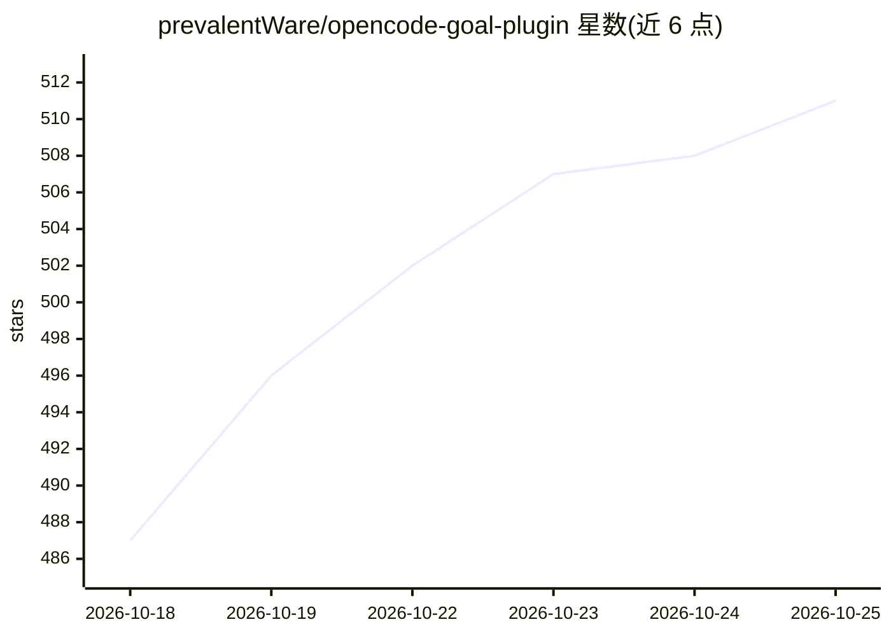

# prevalentWare/opencode-goal-plugin

⭐ 511 · TypeScript · MIT · 推送 2026-10-23 · [GitHub](https://github.com/prevalentWare/opencode-goal-plugin) · [官网](https://www.npmjs.com/package/@prevalentware/opencode-goal-plugin) · 组织维护 · 中文 README

**为 OpenCode 增加 Codex 式长目标模式的 npm 插件**

OpenCode 插件，以 npm 包形式提供，向 AI 编程代理会话注入 /goal、/pause_goal、/resume_goal 斜杠命令与一组 goal 管理 agent 工具（set_goal/update_goal 等 12 个），维护每会话持久化的目标状态、历史、检查点与预算。目标关闭需提供完成证据或具体阻塞说明；支持会话空闲时自动续跑、无进展暂停、预算上限与 Plan-mode 安全限制；目标状态在会话压缩时保留。兼容 OpenCode 1 与 OpenCode 2（opencode2），两者配置格式不同。面向使用 OpenCode 的开发者，通过 opencode plugin 命令全局或项目级安装。

## 筛选速览

| 维度 | 判定 | 备注 |
|---|---|---|
| AI 角色 | `ai-ecosystem` | LLM/agent 周边工具 |
| 许可风险 | `permissive` | MIT |
| 部署形态 | `None` |  |
| 模型依赖 | — | README 未给出锁定关系 |
| 硬件要求 | — | 无带数字的原话,不猜 |
| 安装摩擦 | `low` | 无编译、无系统依赖或容器化 |
| 成熟度 | — | 结构信号不足 |

## 能力要点

- /goal 等斜杠命令与 12 个 goal 管理 agent 工具
- 目标关闭需完成证据或具体阻塞说明
- 持久化每会话目标状态，含历史、检查点、token/时长预算
- 空闲自动续跑、无进展暂停与 Plan-mode 安全限制

## 适用场景

- 让 OpenCode 代理在长重构、迁移、评审或修测试会话中保持单一目标
- 跨 TUI/桌面/Web 界面跟踪同一个显式目标
- 要求代理提交完成证据后才能关闭目标

## 场景标签

`编码 Agent` · 领域:编码与开发

## 证据(README 行号)

> L7: OpenCode Goal Plugin adds Codex-style long-running goal mode to OpenCode. It gives AI coding agents a `/goal` slash 
> L19: - `/goal <objective>`, `/pause_goal`, and `/resume_goal` as OpenCode commands for TUI, desktop, web, and remote int

## 星数曲线

2026-10-18 487 → 2026-10-25 511（+24）

---
*卡片 v1 · prompt 1.4 · 生成 2026-10-21 · 置信度 high · 依据 README sha `36d9bd17d5d7` · [字段定义](../../DATASET.md)*
