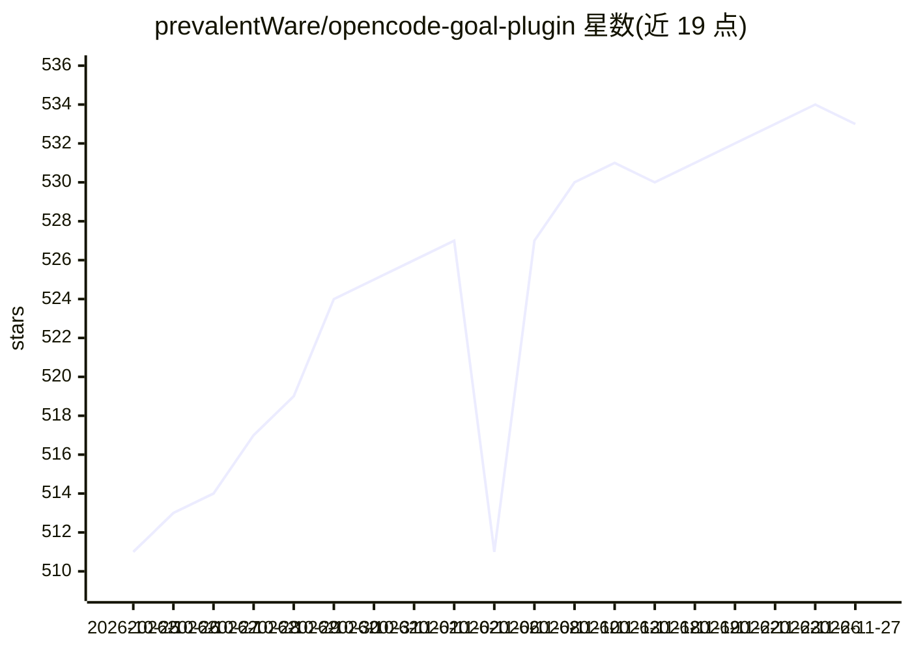

# prevalentWare/opencode-goal-plugin

⭐ 533 · TypeScript · MIT · 推送 2026-11-26 · [GitHub](https://github.com/prevalentWare/opencode-goal-plugin) · [官网](https://www.npmjs.com/package/@prevalentware/opencode-goal-plugin) · 组织维护 · 中文 README

**给 OpenCode 编码代理加持久化目标模式的插件**

为 OpenCode AI 编码代理提供 Codex 风格的长时运行目标模式：通过 /goal、/pause_goal、/resume_goal 斜杠命令与 12 个 agent 工具管理持久化目标状态，要求 complete 状态附验证证据、unstatus 附具体阻塞原因，支持 session.idle 自动续跑、token/时长预算、检查点、历史记录、无进展暂停与 Plan 模式安全限制，目标状态在会话压缩时保留。面向使用 OpenCode TUI/桌面/Web 的开发者，以 npm 插件分发。重要限制：OpenCode 2.2.1+ 已内置 /goal，官方建议多数用户改用内置命令，插件保留给 OpenCode 1 及需要预算、历史、检查点等配置的工作流。

## 筛选速览

| 维度 | 判定 | 备注 |
|---|---|---|
| AI 角色 | `ai-ecosystem` | LLM/agent 周边工具 |
| 许可风险 | `permissive` | MIT |
| 部署形态 | `None` |  |
| 模型依赖 | — | README 未给出锁定关系 |
| 硬件要求 | — | 无带数字的原话,不猜 |
| 安装摩擦 | `low` | 无编译、无系统依赖或容器化 |
| 成熟度 | — | 结构信号不足 |

## 能力要点

- /goal 等斜杠命令与 12 个目标管理 agent 工具
- 目标完成需验证证据，阻塞需具体原因，支持 awaiting_user 暂停
- 自动续跑含 token/时长预算、无进展暂停与失败上限等安全机制
- 目标状态跨会话压缩保留，支持 zh-CN 等本地化配置

## 适用场景

- 让 OpenCode 代理在长时重构、迁移、审查或修测试会话中保持专注
- 在 TUI、桌面与 Web 多端跟踪同一明确目标
- 需要代理完成任务时必须给出验证证据
- OpenCode 1 环境或需要目标预算/历史/检查点的工作流

## 场景标签

`编码 Agent` · 领域:编码与开发

## 证据(README 行号)

> L23: OpenCode Goal Plugin adds Codex-style long-running goal mode to OpenCode. It gives AI coding agents a `/goal` slash
> L37: - `/goal <objective>`, `/pause_goal`, and `/resume_goal` as OpenCode commands for TUI, desktop, web, and remote int
> L39: - Agent tools: `get_goal`, `get_goal_history`, `list_all_goals`, `create_goal`, `set_goal`, `update_goal_objective`

## 星数曲线

2026-10-25 511 → 2026-11-27 533（+22）

---
*卡片 v1 · prompt 1.4 · 生成 2026-11-25 · 置信度 high · 依据 README sha `2186089ff107` · [字段定义](../../DATASET.md)*
