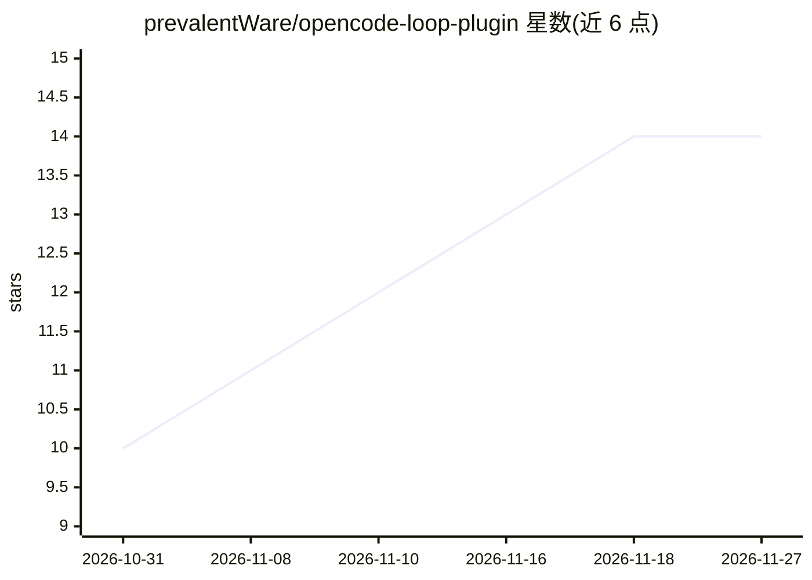

# prevalentWare/opencode-loop-plugin

⭐ 14 · TypeScript · MIT · 推送 2026-10-27 · [GitHub](https://github.com/prevalentWare/opencode-loop-plugin) · [官网](https://www.npmjs.com/package/@prevalentware/opencode-loop-plugin) · 个人维护

**为 OpenCode 提供 Claude Code 风格 /loop 循环提示调度的插件**

面向 OpenCode 的插件，为 AI 编码代理添加 /loop 斜杠命令：由服务端持久调度器在会话空闲时按间隔或代理自选延迟重新注入指令，支持固定间隔、动态步调、keep_alive 后台会话保活等循环类型，并提供 create_loop/stop_loop/schedule_next_run 等 8 个代理工具。状态持久化可跨重启恢复，带最小间隔、每会话循环数上限、7 天自动过期等安全限制。通过 opencode plugin 命令安装，兼容 OpenCode 1 与 2。

## 筛选速览

| 维度 | 判定 | 备注 |
|---|---|---|
| AI 角色 | `ai-ecosystem` | LLM/agent 周边工具 |
| 许可风险 | `permissive` | MIT |
| 部署形态 | `None` |  |
| 模型依赖 | — | README 未给出锁定关系 |
| 硬件要求 | — | 无带数字的原话,不猜 |
| 安装摩擦 | `low` | 无编译、无系统依赖或容器化 |
| 成熟度 | — | 结构信号不足 |

## 能力要点

- 空闲时才注入迭代提示的服务端持久调度器，带 busy 退避
- 动态循环：代理通过 schedule_next_run 自选下次延迟
- 8 个代理工具与 TUI 侧边栏管理循环
- 状态原子写入、跨重启恢复、7 天自动过期等安全限制

## 适用场景

- 让编码代理定时巡检 CI 与部署状态
- 轮询 PR 评审与新 issue 并自动处理
- 长期监控外部状态而无需人工反复发提示

## 场景标签

`编码 Agent` · 领域:编码与开发

## 证据(README 行号)

> L7: OpenCode Loop Plugin adds Claude Code-style `/loop` recurring prompts to OpenCode. It gives AI coding agents a `/loo
> L17: - Agent tools: `create_loop`, `list_loops`, `stop_loop`, `pause_loop`, `resume_loop`, `run_loop`, `schedule_next_ru
> L40: opencode plugin @prevalentware/opencode-loop-plugin

## 星数曲线

2026-10-31 10 → 2026-11-27 14（+4）

---
*卡片 v1 · prompt 1.4 · 生成 2026-11-18 · 置信度 high · 依据 README sha `509b7f1c2ba4` · [字段定义](../../DATASET.md)*
