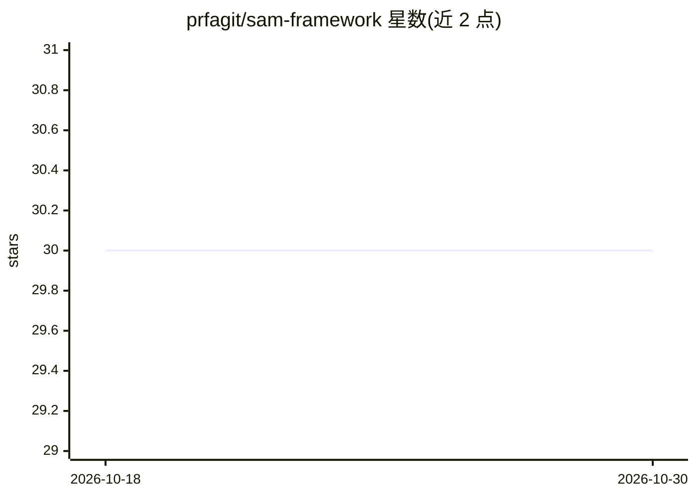

# prfagit/sam-framework

⭐ 30 · Python · NOASSERTION · 推送 2026-06-11 · [GitHub](https://github.com/prfagit/sam-framework) · [官网](https://prfa.me) · 个人维护

**构建可操作 Solana 链上工作流 AI agent 的 Python 中间件框架**

面向加密领域 agent 开发的 Python 框架：提供多提供商 LLM 接入（OpenAI、Anthropic、xAI 及本地兼容端点）、带重试与循环控制的工具调用、SQLite 持久会话、Fernet/OS keyring 加密的密钥与钱包存储、策略驱动的工具访问、插件系统与事件总线。内置 Solana 钱包/交易验证、Jupiter、DexScreener、Hyperliquid、Polymarket 等集成，提供 CLI、HTTP API 和 Streamlit 三种运行界面。安装采用 git clone 加 uv sync，经 `sam onboard` 引导配置。README 明确声明其控制机制不使自动化交易变安全。

## 筛选速览

| 维度 | 判定 | 备注 |
|---|---|---|
| AI 角色 | `ai-ecosystem` | LLM/agent 周边工具 |
| 许可风险 | `none` | NOASSERTION |
| 部署形态 | `None` |  |
| 模型依赖 | — | README 未给出锁定关系 |
| 硬件要求 | — | 无带数字的原话,不猜 |
| 安装摩擦 | `low` | 无编译、无系统依赖或容器化 |
| 成熟度 | — | 结构信号不足 |

## 能力要点

- 多提供商 LLM 支持（OpenAI/Anthropic/xAI/本地兼容端点）
- Fernet 与 OS keyring 加密的钱包和密钥存储
- 策略驱动的工具访问与插件 SDK 扩展
- CLI、HTTP API 与 Streamlit 三种运行界面

## 适用场景

- 构建能持有上下文并调用工具的 Solana 交易/行情 agent
- 通过 HTTP API 将 agent 接入前端或服务
- 用 Streamlit 界面观察工具调用、事件与钱包状态

## 场景标签

`Agent 框架` `金融量化` · 领域:Agent 开发

## 证据(README 行号)

> L5: SAM is a Python framework for building AI agents that can hold context, call tools, and operate around Solana workfl
> L13: - Multi-provider LLM support across OpenAI, Anthropic, xAI, and local-compatible endpoints

## 星数曲线

2026-10-18 30 → 2026-10-30 30（+0）

---
*卡片 v1 · prompt 1.4 · 生成 2026-10-26 · 置信度 high · 依据 README sha `c364afaf0456` · [字段定义](../../DATASET.md)*
