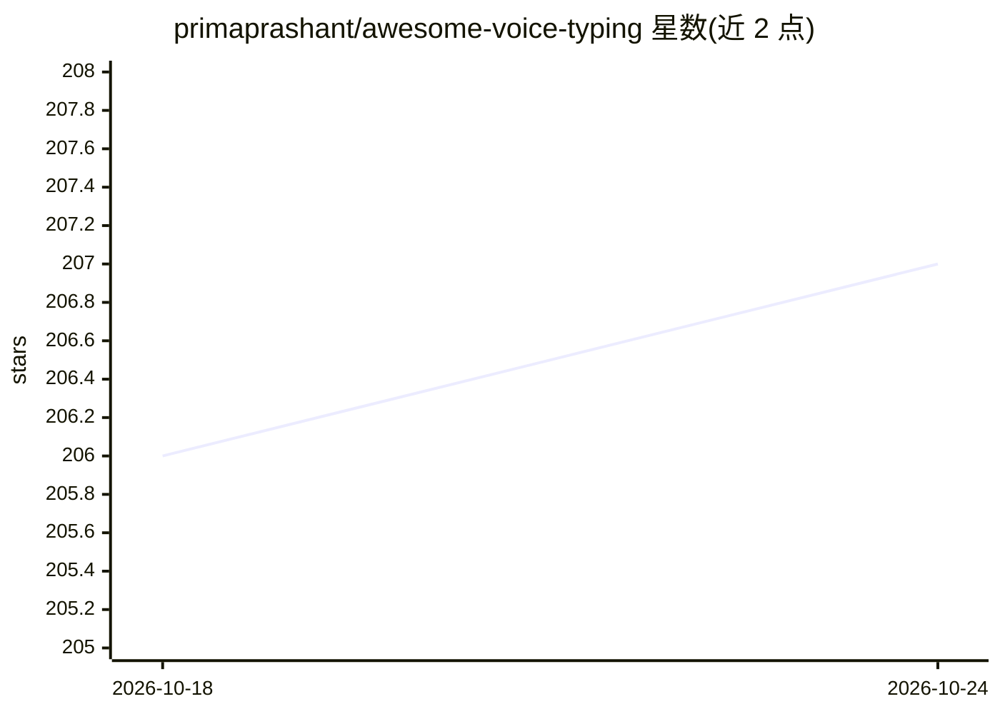

# primaprashant/awesome-voice-typing

⭐ 207 · Python · MIT · 推送 2026-10-24 · [GitHub](https://github.com/primaprashant/awesome-voice-typing) · [官网](https://www.agenticcodingweekly.com/p/5-best-open-source-speech-to-text-tools-in-2026) · 个人维护

**开源语音输入/听写工具策展清单（桌面、移动、CLI）**

策展类 awesome 清单，收录各平台开源语音转文字与听写工具：覆盖 Linux/macOS/Windows/Android/iOS 与 CLI，条目按平台、运行模式（本地/混合/云端）、识别引擎（Whisper 系列、Parakeet、SenseVoice、Vosk 等）与功能摘要以表格组织，并附 30 天 Star 增长趋势、Hacker News 讨论索引及相关 ASR 引擎说明。范围限定为带听写工作流的开源应用/键盘/CLI，不含闭源产品、会议机器人与独立语音 API。面向寻找语音输入工具的用户与选型者。

## 筛选速览

| 维度 | 判定 | 备注 |
|---|---|---|
| AI 角色 | `ai-knowledge` | 知识聚合/清单类 |
| 许可风险 | `permissive` | MIT |
| 部署形态 | `None` |  |
| 模型依赖 | — | README 未给出锁定关系 |
| 硬件要求 | — | 无带数字的原话,不猜 |
| 安装摩擦 | `medium` | 含编译或系统依赖之一 |
| 成熟度 | — | 结构信号不足 |

## 能力要点

- 按平台/模式/引擎/摘要四维组织约 40+ 条听写工具条目
- 区分 Local/Hybrid/Cloud 三种运行模式
- 附 30 天 Star 趋势表与 Hacker News 讨论索引
- 列出 Whisper/whisper.cpp/Faster Whisper/WhisperKit/Parakeet/Vosk 等引擎说明

## 适用场景

- 按平台和离线需求挑选开源语音听写工具
- 了解各工具支持的识别引擎与云/本地模式
- 查看近期社区热度的工具趋势与讨论

## 场景标签

`精选清单` · 领域:学习与行业

## 证据(README 行号)

> L7: A curated list of open-source speech-to-text tools for voice typing and dictation across desktop, mobile, and CLI.
> L117: This list focuses on open-source apps, keyboards, and CLI tools for voice typing and dictation across desktop, mob

## 星数曲线

2026-10-18 206 → 2026-10-24 207（+1）

---
*卡片 v1 · prompt 1.4 · 生成 2026-10-22 · 置信度 high · 依据 README sha `0e233674f06b` · [字段定义](../../DATASET.md)*
