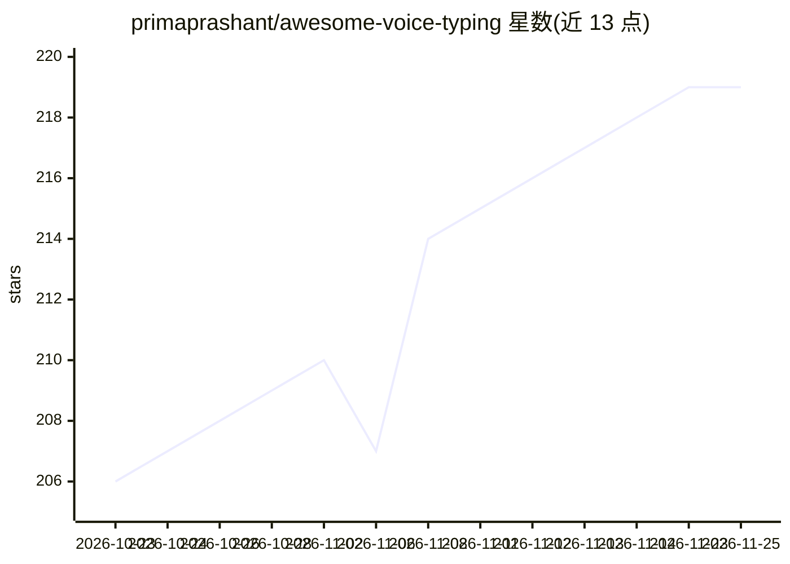

# primaprashant/awesome-voice-typing

⭐ 219 · Python · MIT · 推送 2026-11-24 · [GitHub](https://github.com/primaprashant/awesome-voice-typing) · [官网](https://www.agenticcodingweekly.com/p/5-best-open-source-speech-to-text-tools-in-2026) · 个人维护

**开源语音输入/语音转文字工具策展清单（桌面/移动/CLI）**

覆盖 Linux、macOS、Windows、Android、iOS 的开源语音转文字与听写工具清单，按目录表组织 50 余个条目，标注平台、运行模式（Local/Hybrid/Cloud）与所用 ASR 引擎。提供 30 天增长趋势表、Hacker News 讨论索引与推荐速查；附相关语音识别引擎/模型章节（Whisper、whisper.cpp、Parakeet、Vosk 等）。范围限定于带听写工作流的开源应用、键盘与 CLI 工具，排除闭源产品、会议机器人与独立语音 API。

## 筛选速览

| 维度 | 判定 | 备注 |
|---|---|---|
| AI 角色 | `ai-knowledge` | 知识聚合/清单类 |
| 许可风险 | `permissive` | MIT |
| 部署形态 | `None` |  |
| 模型依赖 | — | README 未给出锁定关系 |
| 硬件要求 | — | 无带数字的原话,不猜 |
| 安装摩擦 | `medium` | 含编译或系统依赖之一 |
| 成熟度 | — | 结构信号不足 |

## 能力要点

- 50+ 开源语音输入工具条目，标注平台、Local/Hybrid/Cloud 模式与引擎
- 30 天 Star 增长趋势表与 Hacker News 讨论索引
- 相关引擎章节收录 Whisper、whisper.cpp、Faster Whisper、WhisperKit、Parakeet、Vosk、Apple Speech
- 范围声明：仅收录开源、带听写工作流的工具

## 适用场景

- 为自己的操作系统挑选本地离线的语音听写工具
- 了解语音输入工具所依赖的 ASR 引擎与模型生态
- 按本地/云模式偏好筛选可用的听写方案

## 场景标签

`精选清单` · 领域:学习与行业

## 证据(README 行号)

> L7: A curated list of open-source speech-to-text tools for voice typing and dictation across desktop, mobile, and CLI.
> L49: `Mode`: `Local` means on-device speech recognition. `Hybrid` means the tool supports both local and cloud or BYO-cl
> L106: Speech recognition engines, models, and APIs that power the tools listed above.

## 星数曲线

2026-10-23 206 → 2026-11-25 219（+13）

---
*卡片 v1 · prompt 1.4 · 生成 2026-11-25 · 置信度 high · 依据 README sha `d05269e82f8c` · [字段定义](../../DATASET.md)*
