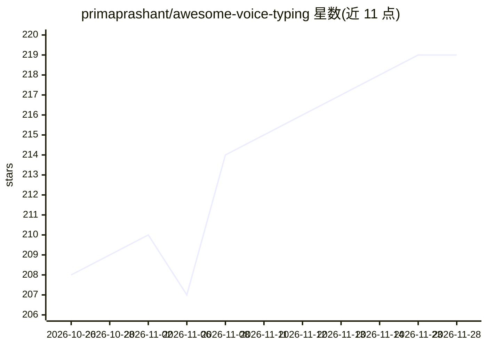

# primaprashant/awesome-voice-typing

⭐ 219 · Python · MIT · 推送 2026-11-27 · [GitHub](https://github.com/primaprashant/awesome-voice-typing) · [官网](https://www.agenticcodingweekly.com/p/5-best-open-source-speech-to-text-tools-in-2026) · 个人维护

**开源语音输入/语音转文字工具的跨平台策展清单**

收录桌面、移动端与 CLI 的开源语音转文字与听写工具，按目录表组织，每条标注支持平台、运行模式（Local/Hybrid/Cloud）与所用引擎（Whisper、Parakeet、SenseVoice、Vosk 等）。附 30 天星标增长榜、Hacker News 讨论索引和相关底层 ASR 引擎/模型列表。范围限定开源听写类工具，闭源产品、会议机器人与独立语音 API 不收录。以 MIT 许可发布，接受 PR。

## 筛选速览

| 维度 | 判定 | 备注 |
|---|---|---|
| AI 角色 | `ai-knowledge` | 知识聚合/清单类 |
| 许可风险 | `permissive` | MIT |
| 部署形态 | `None` |  |
| 模型依赖 | — | README 未给出锁定关系 |
| 硬件要求 | — | 无带数字的原话,不猜 |
| 安装摩擦 | `medium` | 含编译或系统依赖之一 |
| 成熟度 | — | 结构信号不足 |

## 能力要点

- 目录表按平台/模式/引擎三维度标注约 50 个工具
- 附 30 天星标增长榜与 Hacker News 讨论汇总
- 相关项目区列出 Whisper、whisper.cpp、Faster Whisper 等底层引擎
- Scope 章节明确收录与排除标准

## 适用场景

- 为自己的操作系统挑选离线语音听写工具
- 按本地/混合/云端模式筛选符合隐私需求的方案
- 了解语音输入工具生态与社区热度趋势

## 场景标签

`精选清单` `语音识别` · 领域:学习与行业

## 证据(README 行号)

> L7: A curated list of open-source speech-to-text tools for voice typing and dictation across desktop, mobile, and CLI.
> L49: `Mode`: `Local` means on-device speech recognition. `Hybrid` means the tool supports both local and cloud or BYO-cl
> L119: This list focuses on open-source apps, keyboards, and CLI tools for voice typing and dictation across desktop, mob

## 星数曲线

2026-10-26 208 → 2026-11-28 219（+11）

---
*卡片 v1 · prompt 1.4 · 生成 2026-11-28 · 置信度 high · 依据 README sha `2798ce9e5f98` · [字段定义](../../DATASET.md)*
