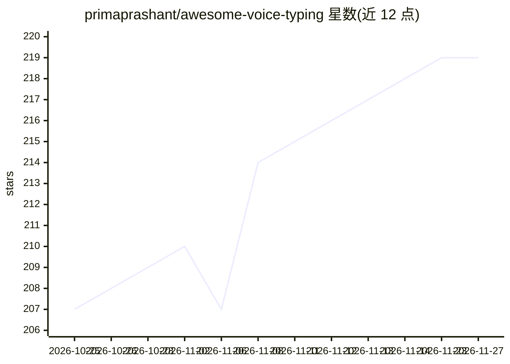

# primaprashant/awesome-voice-typing

⭐ 219 · Python · MIT · 推送 2026-11-26 · [GitHub](https://github.com/primaprashant/awesome-voice-typing) · [官网](https://www.agenticcodingweekly.com/p/5-best-open-source-speech-to-text-tools-in-2026) · 个人维护

**开源语音输入/语音转文字工具策展清单（跨平台 50+ 款）**

按 MIT 许可维护的 awesome 清单，收录面向 Linux、macOS、Windows、Android、iOS 与 CLI 的开源语音转文字与听写工具。条目以目录表组织，按平台、模式（本地/混合/云）与识别引擎标注；另含 30 天星标增长榜、Hacker News 讨论汇总、相关识别引擎（Whisper、whisper.cpp、Parakeet、Vosk 等）介绍，并在 Scope 部分明确排除闭源产品、会议机器人与独立语音 API。

## 筛选速览

| 维度 | 判定 | 备注 |
|---|---|---|
| AI 角色 | `ai-knowledge` | 知识聚合/清单类 |
| 许可风险 | `permissive` | MIT |
| 部署形态 | `None` |  |
| 模型依赖 | — | README 未给出锁定关系 |
| 硬件要求 | — | 无带数字的原话,不猜 |
| 安装摩擦 | `medium` | 含编译或系统依赖之一 |
| 成熟度 | — | 结构信号不足 |

## 能力要点

- 50+ 款工具的目录表，含平台/模式/引擎三列标注
- 30 天星标增长榜与 HN 讨论汇总
- 区分 Local/Hybrid/Cloud 三种识别模式
- 收录底层识别引擎（whisper.cpp、Parakeet、Vosk 等）介绍

## 适用场景

- 为 Linux/macOS/Windows 找离线语音听写工具
- 对比各语音输入应用的本地与云识别引擎选型
- 了解开源语音转文字生态的近期热点项目

## 场景标签

`精选清单` `语音识别` · 领域:学习与行业

## 证据(README 行号)

> L7: A curated list of open-source speech-to-text tools for voice typing and dictation across desktop, mobile, and CLI.
> L119: This list focuses on open-source apps, keyboards, and CLI tools for voice typing and dictation across desktop, mob

## 星数曲线

2026-10-25 207 → 2026-11-27 219（+12）

---
*卡片 v1 · prompt 1.4 · 生成 2026-11-27 · 置信度 high · 依据 README sha `7655e60afe22` · [字段定义](../../DATASET.md)*
