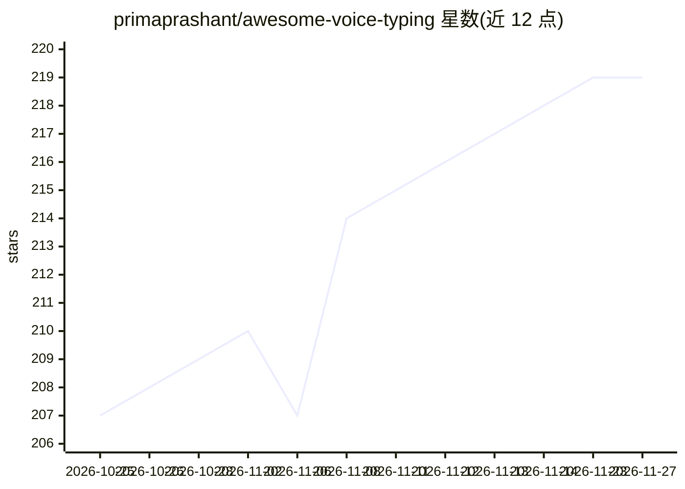

# primaprashant/awesome-voice-typing

⭐ 219 · Python · MIT · 推送 2026-11-26 · [GitHub](https://github.com/primaprashant/awesome-voice-typing) · [官网](https://www.agenticcodingweekly.com/p/5-best-open-source-speech-to-text-tools-in-2026) · 个人维护

**开源语音输入与语音转文字工具的策展清单**

收录覆盖 Linux、macOS、Windows、Android、iOS 的开源语音输入/听写工具，按 Directory 表格组织，标注平台、运行模式（Local/Hybrid/Cloud）与所用 ASR 引擎。附近 30 天增长排行、Hacker News 讨论列表、相关 ASR 引擎与模型资源（Whisper、Parakeet、Vosk 等），并声明收录范围：排除闭源产品、会议机器人与独立语音 API。以清单形式提供，MIT 许可，接受 PR。

## 筛选速览

| 维度 | 判定 | 备注 |
|---|---|---|
| AI 角色 | `ai-knowledge` | 知识聚合/清单类 |
| 许可风险 | `permissive` | MIT |
| 部署形态 | `None` |  |
| 模型依赖 | — | README 未给出锁定关系 |
| 硬件要求 | — | 无带数字的原话,不猜 |
| 安装摩擦 | `medium` | 含编译或系统依赖之一 |
| 成熟度 | — | 结构信号不足 |

## 能力要点

- 约 50 个工具按平台、Local/Hybrid/Cloud 模式与引擎三维度编目
- 含近 30 天 Star 增长排行与 Hacker News 讨论索引
- Related Projects 部分列出 Whisper、whisper.cpp、Parakeet、Vosk 等底层引擎
- 声明 Scope：仅收录开源听写类工具

## 适用场景

- 为 Linux/macOS/Windows 挑选本地离线的按住说话听写工具
- 找 Android/iOS 上的开源语音输入键盘
- 按隐私需求筛选纯本地推理或 BYOK 云端的方案
- 了解语音听写工具所用的 ASR 引擎生态

## 场景标签

`精选清单` · 领域:学习与行业

## 证据(README 行号)

> L7: A curated list of open-source speech-to-text tools for voice typing and dictation across desktop, mobile, and CLI.
> L119: This list focuses on open-source apps, keyboards, and CLI tools for voice typing and dictation across desktop, mob

## 星数曲线

2026-10-25 207 → 2026-11-27 219（+12）

---
*卡片 v1 · prompt 1.4 · 生成 2026-11-26 · 置信度 high · 依据 README sha `f1d26ba262a4` · [字段定义](../../DATASET.md)*
