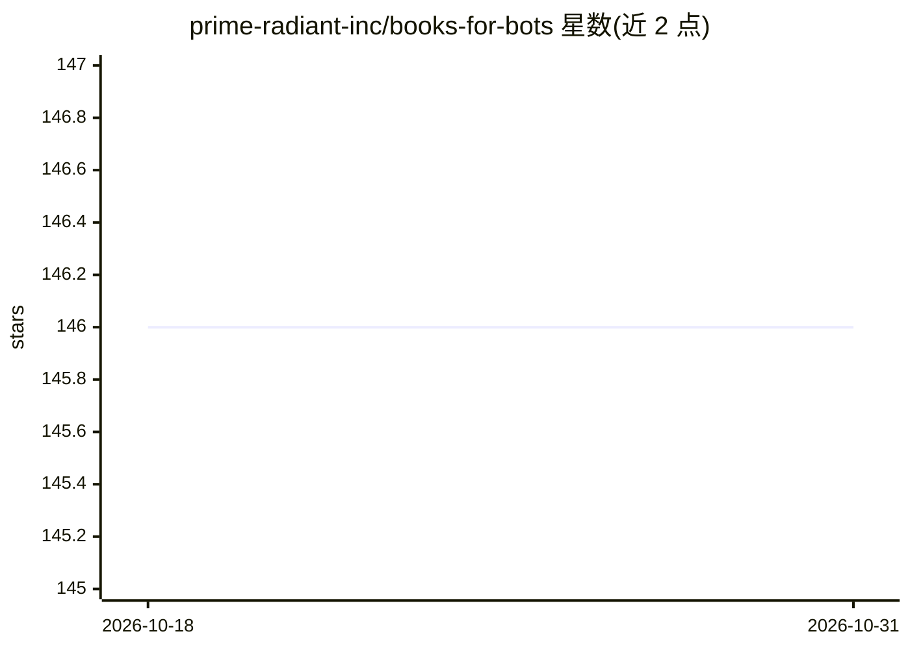

# prime-radiant-inc/books-for-bots

⭐ 146 · Rust · MIT · 推送 2026-08-06 · [GitHub](https://github.com/prime-radiant-inc/books-for-bots) · 组织维护

**把 EPUB 转成带章节偏移的 Markdown，供 LLM agent 定位阅读**

Rust 编写的 CLI 工具，将 EPUB 电子书转换为单一 Markdown 文件：YAML frontmatter 记录每章的绝对字节与行偏移，agent 可按 offset/limit 直接定位章节，无需解包 zip 或解析 OPF/spine。转换遵循确定性原则（相同输入输出逐字节一致）、不做摘要或取舍判断、保留全部文本。五阶段 Rust 管线，二进制约 2000 行，静态链接无运行时依赖。CLI 仅三个参数（输入/输出目录/--force）。通过 cargo 从源码安装并编译。

## 筛选速览

| 维度 | 判定 | 备注 |
|---|---|---|
| AI 角色 | `ai-ecosystem` | LLM/agent 周边工具 |
| 许可风险 | `permissive` | MIT |
| 部署形态 | `library` | 以包/库形式分发 |
| 模型依赖 | — | README 未给出锁定关系 |
| 硬件要求 | — | 无带数字的原话,不猜 |
| 安装摩擦 | `medium` | 含编译或系统依赖之一 |
| 成熟度 | — | 结构信号不足 |

## 能力要点

- YAML frontmatter 记录每章绝对字节与行偏移，构成导航 API
- 确定性转换：相同输入产生逐字节一致的输出
- 不做摘要与内容取舍，保留全部 spine 文本
- 静态链接二进制，约 2000 行 Rust，无运行时依赖

## 适用场景

- 为 LLM agent 准备可按偏移分块读取的书籍语料
- 将 EPUB 转为 Markdown 以节省上下文窗口的解析开销
- 批量转换书籍为可稳定寻址的单一文件

## 场景标签

`文档解析` · 领域:知识与检索

## 证据(README 行号)

> L3: Convert an EPUB into a single YAML-headed Markdown file optimized for token-efficient reading by LLM agents.
> L11: `books-for-bots` flips that. Each book becomes one plain GFM Markdown file with a YAML frontmatter listing every ch

## 星数曲线

2026-10-18 146 → 2026-10-31 146（+0）

---
*卡片 v1 · prompt 1.4 · 生成 2026-10-23 · 置信度 high · 依据 README sha `9bdc9e0ec2d6` · [字段定义](../../DATASET.md)*
