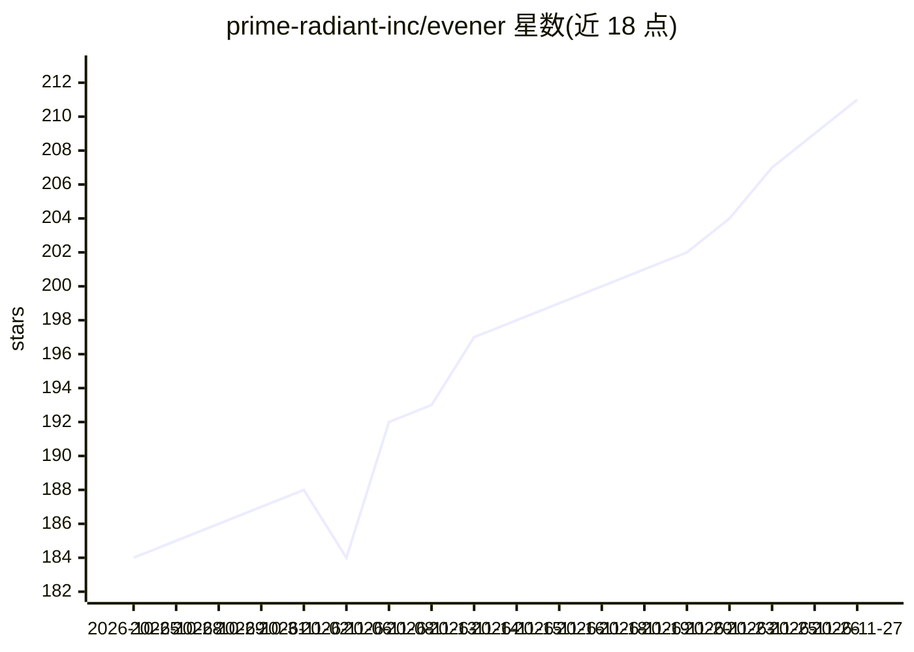

# prime-radiant-inc/evener

⭐ 211 · Go · MIT · 推送 2026-11-26 · [GitHub](https://github.com/prime-radiant-inc/evener) · 组织维护

**循环读写代码并运行命令的编码 agent，CLI/浏览器/iPhone 可用**

Evener 是运行在用户项目中的编码 agent：给定提示词后，以循环方式读取文件、运行命令、编辑代码并检查结果，通过原生工具调用接入 OpenAI、Anthropic、Google 等模型提供方。核心架构为 hub 服务，连接 CLI、浏览器界面与 iPhone 客户端多种入口，支持会话恢复、delegates、jobs 与 memory 等机制。文档提醒使用前评估沙箱隔离，避免在提示词或源文件中放置凭据。

## 筛选速览

| 维度 | 判定 | 备注 |
|---|---|---|
| AI 角色 | `ai-native` | 本体是模型或模型工具 |
| 许可风险 | `permissive` | MIT |
| 部署形态 | `None` |  |
| 模型依赖 | — | README 未给出锁定关系 |
| 硬件要求 | — | 无带数字的原话,不猜 |
| 安装摩擦 | `low` | 无编译、无系统依赖或容器化 |
| 成熟度 | — | 结构信号不足 |

## 能力要点

- 读取文件、运行命令、编辑代码并自检的循环式编码 agent
- hub 服务统一连接 CLI、浏览器与 iPhone 客户端
- 原生工具调用方式接入 OpenAI/Anthropic/Google 模型
- 监听地址、客户端目的地与 public_url 分离的可配置部署

## 适用场景

- 用一段提示词让 agent 自动修复带自测的小程序
- 从脚本中以 CLI 方式运行编码任务
- 通过 iPhone 客户端远程查看和引导会话进展

## 场景标签

`编码 Agent` · 领域:编码与开发

## 证据(README 行号)

> L3: Evener is a coding agent that works in your project: it reads files, runs commands, edits code, and checks the resul
> L5: **Get started** to install Evener, connect a model provider, and repair a small program with a check you can run you

## 星数曲线

2026-10-25 184 → 2026-11-27 211（+27）

---
*卡片 v1 · prompt 1.4 · 生成 2026-11-25 · 置信度 mid · 依据 README sha `0542a963debf` · [字段定义](../../DATASET.md)*
