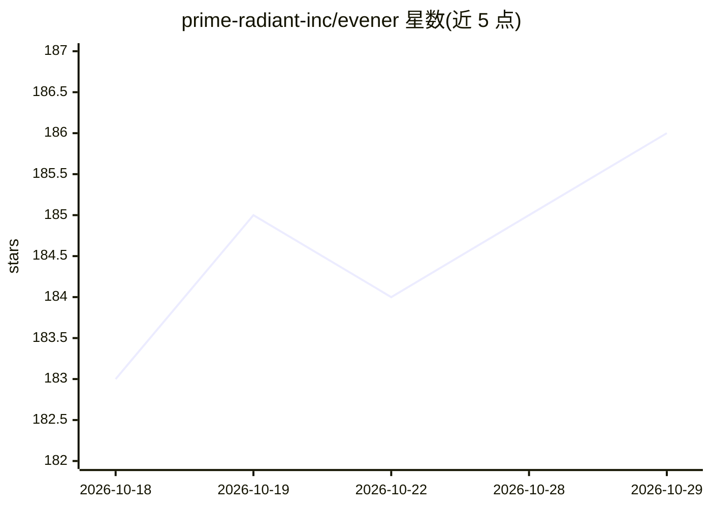

# prime-radiant-inc/evener

⭐ 186 · Go · MIT · 推送 2026-10-28 · [GitHub](https://github.com/prime-radiant-inc/evener) · 组织维护

**在项目内循环读写代码、执行命令的编程 agent**

Go 编写的编码代理：给定目标后循环读取文件、运行命令、编辑代码并检查结果，支持原生工具调用，可接入 OpenAI、Anthropic 与 Google 模型。提供浏览器界面跟跑并干预、CLI 用于脚本化任务、iPhone 客户端远程接入，三者经 hub 服务连接到会话。支持会话、委派、任务与记忆机制，可添加可复用指令和工具。README 提示模型摘要不等于测试结果，并建议审查沙箱与凭据处理。

## 筛选速览

| 维度 | 判定 | 备注 |
|---|---|---|
| AI 角色 | `ai-native` | 本体是模型或模型工具 |
| 许可风险 | `permissive` | MIT |
| 部署形态 | `None` |  |
| 模型依赖 | — | README 未给出锁定关系 |
| 硬件要求 | — | 无带数字的原话,不猜 |
| 安装摩擦 | `low` | 无编译、无系统依赖或容器化 |
| 成熟度 | — | 结构信号不足 |

## 能力要点

- 读文件/运行命令/编辑代码/检查结果的循环式工作流
- 原生工具调用，支持 OpenAI、Anthropic、Google 模型
- 浏览器、CLI、iPhone 客户端三种界面经 hub 连接会话
- 支持会话、委派、任务、记忆与自定义工具扩展

## 适用场景

- 让 agent 在我的项目里完成一个可验证的编码任务
- 通过浏览器跟跑并随时干预 agent 的工作
- 用脚本/CLI 自动化执行编码任务
- 在手机上远程查看和操作开发会话

## 场景标签

`编码 Agent` · 领域:编码与开发

## 证据(README 行号)

> L3: Evener is a coding agent that works in your project: it reads files, runs commands, edits code, and checks the resul
> L5: **Get started** to install Evener, connect a model provider, and repair a small program with a check you can run you

## 星数曲线

2026-10-18 183 → 2026-10-29 186（+3）

---
*卡片 v1 · prompt 1.4 · 生成 2026-10-22 · 置信度 mid · 依据 README sha `1f4d261cc9cc` · [字段定义](../../DATASET.md)*
