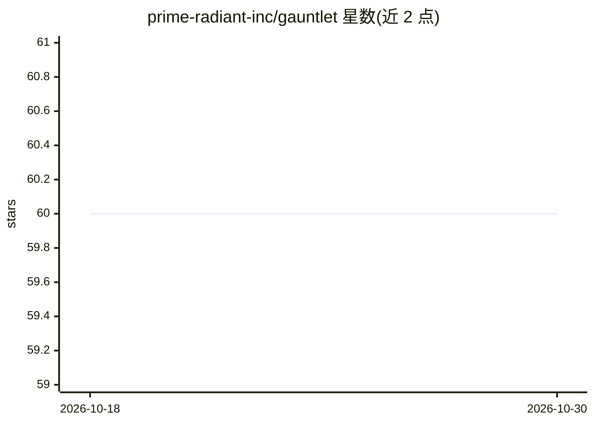

# prime-radiant-inc/gauntlet

⭐ 60 · TypeScript · Apache-2.0 · 推送 2026-09-11 · [GitHub](https://github.com/prime-radiant-inc/gauntlet) · 组织维护

**用 LLM agent 对 Web/CLI/TUI 程序做 QA 测试的框架**

AI 驱动的 QA 测试框架：用户以 markdown story card（标题+描述+验收标准）描述测试，LLM agent 通过三种适配器驱动被测对象——CDP 控制真实 Chrome 的 web 适配器、stdin/stdout 子进程的 cli 适配器、tmux 会话内的 tui 适配器——点击、输入、读屏，最终输出 pass/fail/investigate 判定及证据（截图、观察项、操作日志）。支持 Anthropic 与 OpenAI 两种 provider，fanout 功能可从父卡片自动生成边界/错误路径变体卡片。基于 Bun/TypeScript，提供 Docker 部署与 Web UI（React）。tui 适配器需主机安装 tmux。

## 筛选速览

| 维度 | 判定 | 备注 |
|---|---|---|
| AI 角色 | `ai-ecosystem` | LLM/agent 周边工具 |
| 许可风险 | `permissive` | Apache-2.0 |
| 部署形态 | `self-host` | docker 或自建部署 |
| 模型依赖 | locked-api |  |
| 硬件要求 | — | 无带数字的原话,不猜 |
| 安装摩擦 | `low` | 无编译、无系统依赖或容器化 |
| 成熟度 | — | 结构信号不足 |

## 能力要点

- 三种适配器：Chrome CDP（web）、stdin/stdout（cli）、tmux 会话（tui）
- story card 驱动，输出 pass/fail/investigate 判定与截图、观察项、操作日志
- fanout 自动生成边界、错误路径、不同角色的测试变体卡片
- Anthropic provider 带 prompt caching 以降低长 agent 运行的 token 成本

## 适用场景

- 用自然语言验收标准驱动浏览器端端到端测试
- 测试 CLI 提示交互流与全屏终端 UI（vim/htop 类程序）
- 从已有 bug 观察项自动生成后续针对性测试卡片

## 场景标签

`浏览器自动化` · 领域:效率与自动化

## 证据(README 行号)

> L3: Gauntlet is an AI-powered QA testing framework. It uses large language models (Claude or GPT) to test software the w
> L177: Gauntlet supports two providers via a common `LLMClient` interface:

## 星数曲线

2026-10-18 60 → 2026-10-30 60（+0）

---
*卡片 v1 · prompt 1.4 · 生成 2026-10-24 · 置信度 mid · 依据 README sha `bbd204691cf2` · [字段定义](../../DATASET.md)*
