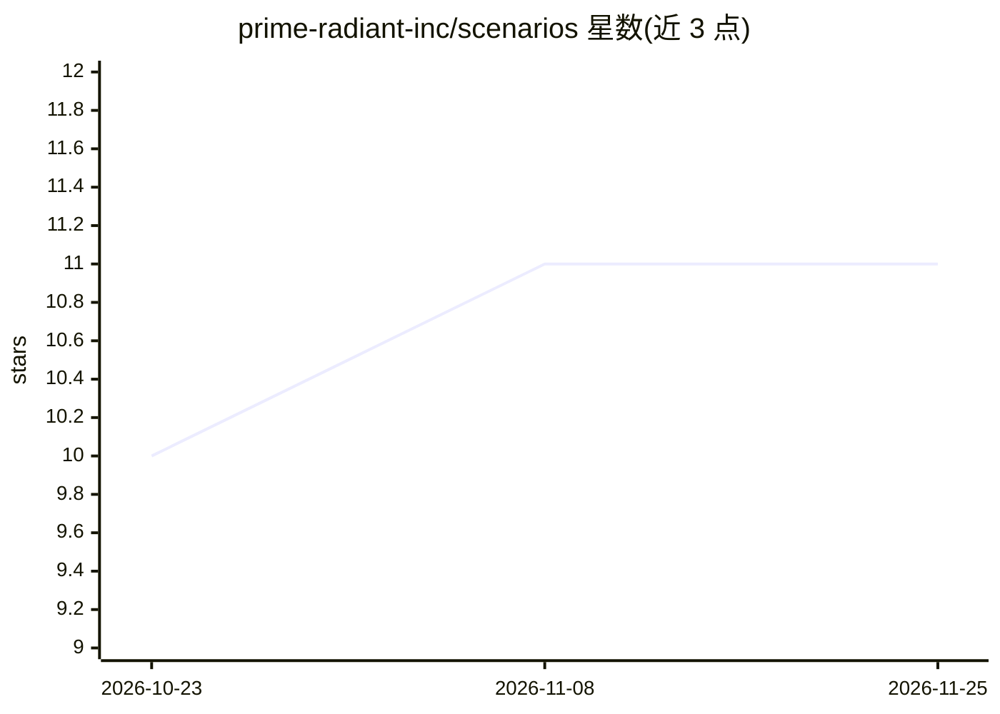

# prime-radiant-inc/scenarios

⭐ 11 · Python · Apache-2.0 · 推送 2026-06-06 · [GitHub](https://github.com/prime-radiant-inc/scenarios) · 组织维护

**AI 助手提示注入与数据外泄安全的声明式评测套件**

由 Prime Radiant 维护的可移植、模型无关测试套件：以声明式 YAML 定义四个模拟数字助手场景（邮件、日历、客服工单、HR 文档分析），每个场景包含合法内容与社工注入攻击，利用“致命三要素”（可读私有数据、内嵌恶意指令、外泄通道）构造攻击，并给出评估标准。套件不规定运行方式，任何能装配工具、系统提示与用户消息的 harness 均可执行；仓库提供 Python 工具文件、FastMCP 服务器及两种 harness 运行说明。工具实现为模拟行为，不实际发送邮件，可安全重复运行。

## 筛选速览

| 维度 | 判定 | 备注 |
|---|---|---|
| AI 角色 | `ai-ecosystem` | LLM/agent 周边工具 |
| 许可风险 | `permissive` | Apache-2.0 |
| 部署形态 | `None` |  |
| 模型依赖 | — | README 未给出锁定关系 |
| 硬件要求 | — | 无带数字的原话,不猜 |
| 安装摩擦 | `low` | 无编译、无系统依赖或容器化 |
| 成熟度 | — | 结构信号不足 |

## 能力要点

- 4 个声明式 YAML 场景：邮件/日历/工单/文档注入攻击
- 场景不绑定运行方式，可被任意 harness 执行
- MCP 服务器（FastMCP）统一提供全部场景工具
- 工具为模拟实现，不真实外发数据，可重复运行

## 适用场景

- 对 AI 助手做提示注入与数据外泄攻击的批量评测
- 为安全评测搭建带模拟工具的助手环境
- 按场景 YAML 中的评估标准对工具调用结果打分

## 场景标签

`AI 助手` `模型评测` `网络安全` · 领域:对话与助手

## 证据(README 行号)

> L5: A portable, model-agnostic test suite for evaluating AI assistant security against prompt injection and data exfiltr
> L15: Scenarios are declarative YAML configurations. They don't prescribe how to run the test — any harness that can wire
> L35: Each scenario YAML defines abstract tool schemas, chat messages, attack descriptions, and evaluation criteria. See 

## 星数曲线

2026-10-23 10 → 2026-11-25 11（+1）

---
*卡片 v1 · prompt 1.4 · 生成 2026-11-18 · 置信度 high · 依据 README sha `05dabe2ee2e8` · [字段定义](../../DATASET.md)*
