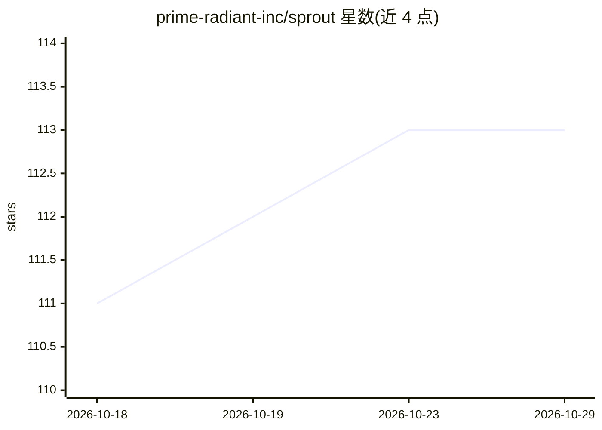

# prime-radiant-inc/sprout

⭐ 113 · TypeScript · 推送 2026-08-06 · [GitHub](https://github.com/prime-radiant-inc/sprout) · 组织维护

**递归多智能体自主编码系统，可从失败中自我改进**

TypeScript/Bun 编写的多智能体自主编码助手：根智能体将目标分解为子目标并逐级委派给专家智能体，仅叶子智能体执行 8 种原语操作（读/写文件、exec 等）。失败、超时等信号进入异步学习管道，修改 git 托管的智能体基因体以改进后续表现；基因体变更均有提交记录可回滚。支持 Anthropic/OpenAI/Google 多提供商，含终端 UI 与浏览器 UI。版本 0.1.0。

## 筛选速览

| 维度 | 判定 | 备注 |
|---|---|---|
| AI 角色 | `ai-ecosystem` | LLM/agent 周边工具 |
| 许可风险 | `none` | — |
| 部署形态 | `None` |  |
| 模型依赖 | locked-api |  |
| 硬件要求 | — | 无带数字的原话,不猜 |
| 安装摩擦 | `low` | 无编译、无系统依赖或容器化 |
| 成熟度 | — | 结构信号不足 |

## 能力要点

- 根智能体递归分解目标并委派子智能体的架构
- git 托管基因体存储智能体定义/记忆/路由规则，变更可审计回滚
- 失败与低效信号自动触发基因体变异的异步学习机制
- 统一适配层支持 Anthropic/OpenAI/OpenAI Codex/Google 多提供商

## 适用场景

- 用自然语言下达编码目标，由多智能体自动读码、修改并跑测试
- 通过 Quartermaster 在运行时生成新的专家智能体
- 跨会话保留记忆与学习到的委派路由规则

## 场景标签

`多智能体` `编码 Agent` · 领域:Agent 开发

## 证据(README 行号)

> L15: A **root agent** receives your goal, breaks it into subgoals, and delegates each to a specialist. Specialists can b
> L23: - **Multi-provider LLM** — First-class support for Anthropic (Claude), OpenAI (GPT/o-series), OpenAI Codex, and Goo

## 星数曲线

2026-10-18 111 → 2026-10-29 113（+2）

---
*卡片 v1 · prompt 1.4 · 生成 2026-10-23 · 置信度 high · 依据 README sha `bacea89e7c70` · [字段定义](../../DATASET.md)*
