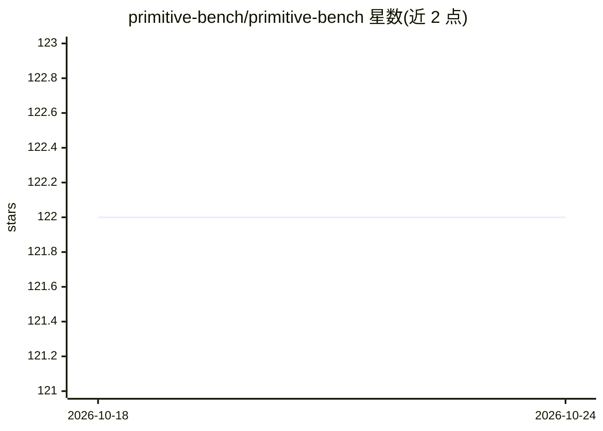

# primitive-bench/primitive-bench

⭐ 122 · Python · Apache-2.0 · 推送 2026-09-03 · [GitHub](https://github.com/primitive-bench/primitive-bench) · [官网](https://www.primitivebench.com/) · 组织维护

**面向工具结果的开放评测与验证层：按场景验证工具是否真正完成**

Primitive Bench 的开源验证层：提供覆盖网页搜索、抽取、OCR、向量库、重排、检索等原语的评测包，通过统一 harness（dataset→Task→Adapter→Scorer）运行评估，按切片用置信区间与统计可分性（McNemar、Wilson、Bradley-Terry/Elo）判定各工具是否真正完成目标，作为市场路由与退款决策的依据；保留集金答案存于私有评测服务器。另提供 MCP 服务器，供 AI agent 查询切片级排行榜。包尚未发布到 PyPI，需从 git clone 用 uv 运行；OCR/向量库/分块/抓取等评测包仍为计划状态。

## 筛选速览

| 维度 | 判定 | 备注 |
|---|---|---|
| AI 角色 | `ai-ecosystem` | LLM/agent 周边工具 |
| 许可风险 | `permissive` | Apache-2.0 |
| 部署形态 | `library` | 以包/库形式分发 |
| 模型依赖 | — | README 未给出锁定关系 |
| 硬件要求 | — | 无带数字的原话,不猜 |
| 安装摩擦 | `low` | 无编译、无系统依赖或容器化 |
| 成熟度 | — | 结构信号不足 |

## 能力要点

- 按原语划分的公开评测包（websearch/extraction/reranker/retrieval 已上线）
- 切片级统计评分：置信区间、可分性检验、平局带机制
- MCP 服务器向 agent 暴露切片级排行榜查询，无服务端 LLM
- harness 形态与 EleutherAI lm-eval / AISI Inspect / HELM 趋同

## 适用场景

- 为我的 agent 查询某类任务下哪个工具在统计上胜出
- 对搜索/抽取/重排/检索工具做可复现的切片级评测
- 为按效果付费的工具路由决策提供证据支撑

## 场景标签

`模型评测` · 领域:评测与运维

## 证据(README 行号)

> L61: The open engine here observes input and output, traces every tool call, and scores the result
> L114: The `bench` CLI scaffolds a config (`bench init`), runs an eval (`bench run`), summarizes slices with
> L120: The verification layer isn't just a site to read, it's a tool your **AI agent can query while it

## 星数曲线

2026-10-18 122 → 2026-10-24 122（+0）

---
*卡片 v1 · prompt 1.4 · 生成 2026-10-23 · 置信度 mid · 依据 README sha `44ff21c64b71` · [字段定义](../../DATASET.md)*
