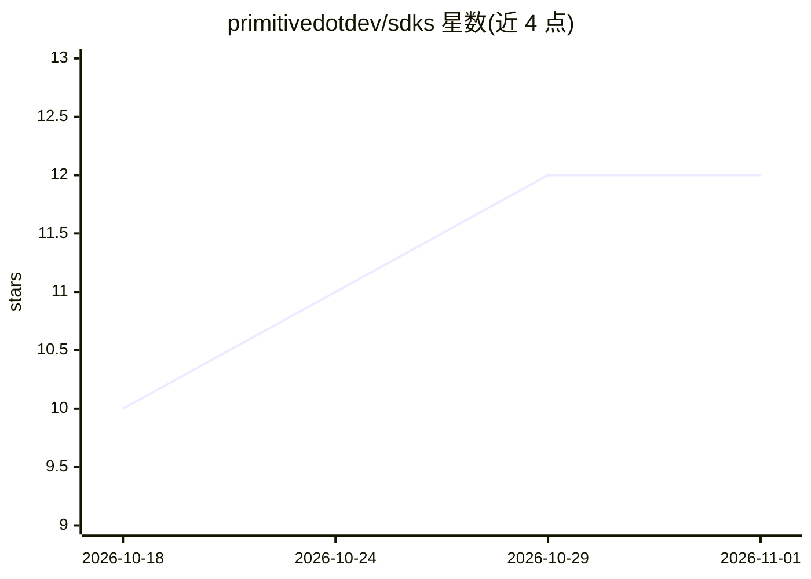

# primitivedotdev/sdks

⭐ 12 · TypeScript · MIT · 推送 2026-10-29 · [GitHub](https://github.com/primitivedotdev/sdks) · [官网](https://www.primitive.dev/) · 组织维护

**面向 AI agent 的邮件平台 Primitive 官方多语言 SDK 与 CLI**

Primitive（收发邮件平台，面向 AI agent）官方 SDK 的 monorepo，由 OpenAPI 规范生成，提供 Node.js、Python、Go 三个语言版本及 primitive CLI。核心工作流为：接收入站邮件、读取规范化邮件对象、同步发送/回复/转发。各 SDK 附带非托管 x402 支付客户端（USDC、base/base-sepolia 网络，密钥不离开调用方），并保留 webhook 验证、生成 HTTP 包、Primitive Memories KV、原始 MIME 解析等低层接口。面向在 primitive.dev 上构建邮件自动化的开发者。

## 筛选速览

| 维度 | 判定 | 备注 |
|---|---|---|
| AI 角色 | `ai-ecosystem` | LLM/agent 周边工具 |
| 许可风险 | `permissive` | MIT |
| 部署形态 | `library` | 以包/库形式分发 |
| 模型依赖 | — | README 未给出锁定关系 |
| 硬件要求 | — | 无带数字的原话,不猜 |
| 安装摩擦 | `low` | 无编译、无系统依赖或容器化 |
| 成熟度 | — | 结构信号不足 |

## 能力要点

- 三语言 SDK（npm/pip/go get 安装）+ primitive CLI
- 默认收发工作流：receive/client/send/reply/forward
- 非托管 x402 支付客户端（USDC，base 与 base-sepolia）
- 低层接口：webhook 验证、OpenAPI 导出、MIME 解析、Memories KV

## 适用场景

- 为 AI agent 接入邮件收发与回复转发能力
- 在 agent 间发起 USDC x402 支付请求与结算
- 通过 MCP server（Claude & ChatGPT connector）或 CLI 操作邮件

## 场景标签

 · 领域:开发者工具/邮件基础设施

## 证据(README 行号)

> L7: Primitive is an inbound and outbound email platform. The SDKs are centered on a
> L104: Everything for building on primitive.dev, the email API for AI agents:

## 星数曲线

2026-10-18 10 → 2026-11-01 12（+2）

---
*卡片 v1 · prompt 1.4 · 生成 2026-11-01 · 置信度 high · 依据 README sha `27e003168869` · [字段定义](../../DATASET.md)*
