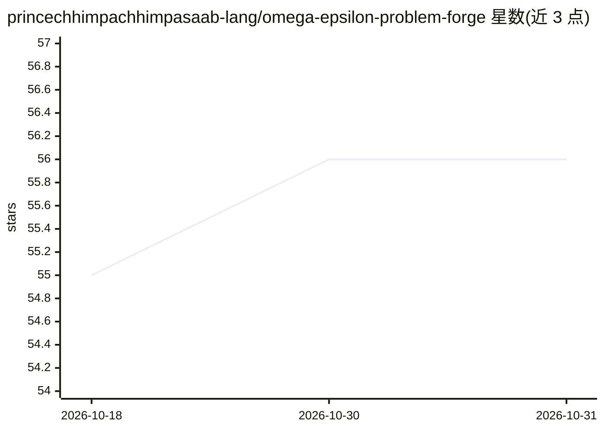

# princechhimpachhimpasaab-lang/omega-epsilon-problem-forge

⭐ 56 · HTML · 推送 2026-10-30 · [GitHub](https://github.com/princechhimpachhimpasaab-lang/omega-epsilon-problem-forge) · 个人维护

**西班牙数学奥赛风格题目合成训练的桌面应用**

基于 PyQt5 的桌面端数学奥赛训练平台：通过随机文法与约束满足引擎按需合成数论、组合、不等式、几何题目（每个领域 22000+ 基础配置、7 档难度），不依赖固定题库；带多级提示逐步解锁、符号代数系统的分步验证与部分给分、16 项微技能认知热图、5 种语言的题面渲染、会话存档回放、Python 插件扩展新领域。需 Python 3.11+，下载平台包后运行启动脚本初始化。README 未展示明确的大模型调用环节；约 0.3% 生成题可能退化或不够严谨。

## 筛选速览

| 维度 | 判定 | 备注 |
|---|---|---|
| AI 角色 | `ai-enhanced` | 去掉 AI 部分产品仍成立 |
| 许可风险 | `none` | — |
| 部署形态 | `None` |  |
| 模型依赖 | — | README 未给出锁定关系 |
| 硬件要求 | — | 无带数字的原话,不猜 |
| 安装摩擦 | `low` | 无编译、无系统依赖或容器化 |
| 成熟度 | — | 结构信号不足 |

## 能力要点

- 随机文法+约束满足引擎合成题目，每领域 22000+ 基础配置、7 档难度
- 符号代数系统的分步验证、部分给分与错误定位
- 16 项微技能认知热图与自适应难度（响应时延/错误模式追踪）
- Python 描述文件插件机制扩展新数学领域

## 适用场景

- 备战数学奥赛做无限量不重复的个性化练习
- 课堂教学中的分层题目生成与诊断
- 追踪自己各数学微技能的强弱并回放解题过程

## 场景标签

 · 领域:教育/数学训练

## 证据(README 行号)

> L16: **OMEGA PROOF ARENA** is not merely another exercise generator. It is a **computational organism** that breathes li
> L24: ### 1. **Algorithmic Creativity**
> L35: ### 🧠 **Infinite Problem Synthesis Engine**

## 星数曲线

2026-10-18 55 → 2026-10-31 56（+1）

---
*卡片 v1 · prompt 1.4 · 生成 2026-10-24 · 置信度 low · 依据 README sha `2ddde9b2bc1d` · [字段定义](../../DATASET.md)*
