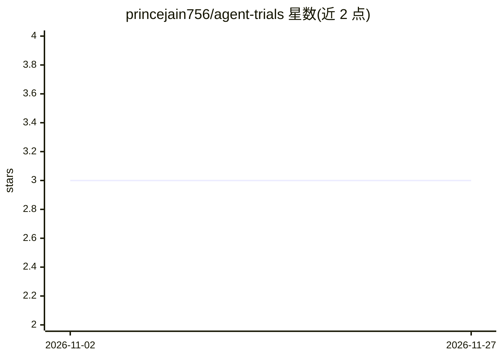

# princejain756/agent-trials

⭐ 3 · TypeScript · MIT · 推送 2026-10-26 · [GitHub](https://github.com/princejain756/agent-trials) · 个人维护

**为开发者提供统一的 coding agent CLI 任务评测工具**

agent-trials 是一个 npm 命令行工具，将同一套任务套件依次运行在用户已安装的多个 coding agent CLI 上，输出计分板：通过情况、耗时、花费。每个任务在仓库的临时副本上运行，verify 命令判定通过与否，verifyPaths 在 agent 运行后从原仓库恢复以防其改写自己的测试。内置 claude/codex/gemini 三种 agent 配置，自定义 agent 通过 argv 数组定义。限制：非安全沙箱，需在一次性 VM 中运行；评分仅有通过/失败两态；需 macOS/Linux 与已登录的 agent CLI。

## 筛选速览

| 维度 | 判定 | 备注 |
|---|---|---|
| AI 角色 | `ai-ecosystem` | LLM/agent 周边工具 |
| 许可风险 | `permissive` | MIT |
| 部署形态 | `library` | 以包/库形式分发 |
| 模型依赖 | — | README 未给出锁定关系 |
| 硬件要求 | — | 无带数字的原话,不猜 |
| 安装摩擦 | `low` | 无编译、无系统依赖或容器化 |
| 成熟度 | — | 结构信号不足 |

## 能力要点

- 同一任务套件跨多个 agent CLI 运行并输出计分板
- verifyPaths 恢复机制防止 agent 改写自己的评分脚本
- 最小环境变量与密钥文件跳过的凭据隔离策略
- 记录每个 cell 实际服务的模型字符串而非请求的模型名

## 适用场景

- 在接入 agent 前验证它能否修复自己仓库的 bug
- 更换 agent 或升级模型版本后重跑套件对比计分板
- 把任务套件提交到仓库作为人工冒烟测试

## 场景标签

`模型评测` · 领域:评测与运维

## 证据(README 行号)

> L11: `agent-trials` runs the same task suite through every coding agent CLI you have installed and prints a scoreboard: 
> L75: Builtin agents: `claude`, `codex`, `gemini`. Custom agents are one argv array away: anything installed, any flags, 

## 星数曲线

2026-11-02 3 → 2026-11-27 3（+0）

---
*卡片 v1 · prompt 1.4 · 生成 2026-11-21 · 置信度 high · 依据 README sha `0e98f087b3bd` · [字段定义](../../DATASET.md)*
