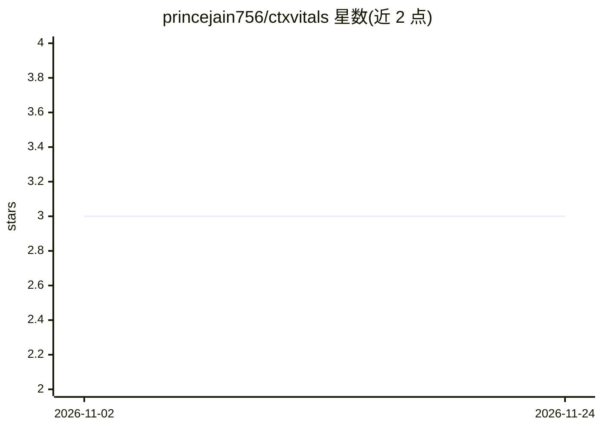

# princejain756/ctxvitals

⭐ 3 · JavaScript · MIT · 推送 2026-10-26 · [GitHub](https://github.com/princejain756/ctxvitals) · [官网](https://www.npmjs.com/package/agentvitals) · 个人维护

**审计 AI agent 栈的 MCP/技能/规则真实 token 成本与安全**

一条命令的审计工具：自行启动每个 stdio MCP 服务器、经 Streamable HTTP 探测远端服务器，读取真实 tools/list schema 计算每回合上下文 token 开销；同时统计 skills 常载 frontmatter 与规则文件 token，检查 curl-pipe-sh、prompt-injection、硬编码密钥等安全问题与重复/失效配置，按 A–F 评分并输出 JSON/HTML 报告与 README 徽章。扫描 ~/.claude、~/.cursor 等多客户端配置目录，零依赖，需 Node 18+。

## 筛选速览

| 维度 | 判定 | 备注 |
|---|---|---|
| AI 角色 | `ai-ecosystem` | LLM/agent 周边工具 |
| 许可风险 | `permissive` | MIT |
| 部署形态 | `library` | 以包/库形式分发 |
| 模型依赖 | — | README 未给出锁定关系 |
| 硬件要求 | — | 无带数字的原话,不猜 |
| 安装摩擦 | `low` | 无编译、无系统依赖或容器化 |
| 成熟度 | — | 结构信号不足 |

## 能力要点

- 启动 MCP 服务器读取真实 tools/list schema，按实测字节数计 token 而非估算
- 安全检查覆盖 prompt-injection 短语、硬编码密钥、非 TLS 远端服务器、未固定版本包
- 重复服务器与失效配置的卫生检查
- A–F 评分卡、JSON/HTML 报告与 README 徽章输出

## 适用场景

- 接入大量 MCP 服务器前评估每回合上下文 token 成本
- 审计 agent 配置中的安全隐患与重复挂载
- 为 MCP 服务器或技能包 README 展示其 token 成本徽章

## 场景标签

 · 领域:AI agent 基础设施/开发工具

## 证据(README 行号)

> L9: **A Lighthouse for your AI agent stack.** One command measures what every MCP
> L47: |**MCP token cost**|Spawns each stdio server and probes remote HTTP servers (Streamable HTTP transport) for the rea
> L54: It scans `~/.claude`, `~/.cursor`, `~/.codeium/windsurf`, `~/.copilot`,

## 星数曲线

2026-11-02 3 → 2026-11-24 3（+0）

---
*卡片 v1 · prompt 1.4 · 生成 2026-11-21 · 置信度 high · 依据 README sha `4133615b4eae` · [字段定义](../../DATASET.md)*
