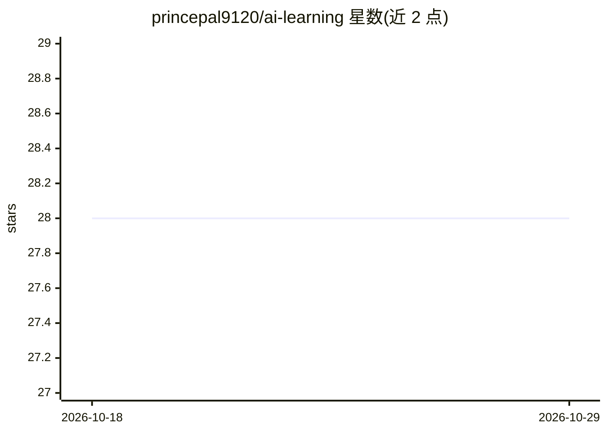

# princepal9120/ai-learning

⭐ 28 · Jupyter Notebook · 推送 2026-04-29 · [GitHub](https://github.com/princepal9120/ai-learning) · 个人维护 · 中文 README

**AI/ML/GenAI/Agentic AI 学习路线资源清单**

以主题大纲形式组织的学习资源仓库：从数学基础、Python、ML、深度学习、MLOps、Transformers，到 LangChain、RAG、向量数据库与 Agentic AI，共 40+ 主题。每个主题给出描述并列出免费学习资源，其中印地语资源主要来自 CampusX 与 Krish Naik，英语资源涵盖官方文档、论文与课程。另在多阶段附项目实践清单（分类应用、RAG 问答、多智能体研究助手等），标注所用数据集与技术栈。仓库不含代码实现，仅为链接索引与大纲。

## 筛选速览

| 维度 | 判定 | 备注 |
|---|---|---|
| AI 角色 | `ai-knowledge` | 知识聚合/清单类 |
| 许可风险 | `none` | — |
| 部署形态 | `None` |  |
| 模型依赖 | — | README 未给出锁定关系 |
| 硬件要求 | — | 无带数字的原话,不猜 |
| 安装摩擦 | `low` | 无编译、无系统依赖或容器化 |
| 成熟度 | — | 结构信号不足 |

## 能力要点

- 40+ 主题覆盖数学/ML/DL/MLOps/LLM/Agentic AI 全路径
- 每主题并列提供印地语与英语免费学习资源
- 6 组项目实践清单，标注数据集与技术栈（LangChain/FAISS/ChromaDB 等）

## 适用场景

- 按大纲系统自学从 ML 基础到 Agentic AI
- 为各阶段寻找配套的免费视频/文档/论文资源
- 参照项目清单做动手实践

## 场景标签

`精选清单` · 领域:学习与行业

## 证据(README 行号)

> L1: # 🚀 Complete AI Learning Roadmap
> L3: > _Your comprehensive guide to mastering GenAI and Agentic AI — from fundamentals to advanced deployment_

## 星数曲线

2026-10-18 28 → 2026-10-29 28（+0）

---
*卡片 v1 · prompt 1.4 · 生成 2026-10-26 · 置信度 high · 依据 README sha `333f6a58296c` · [字段定义](../../DATASET.md)*
