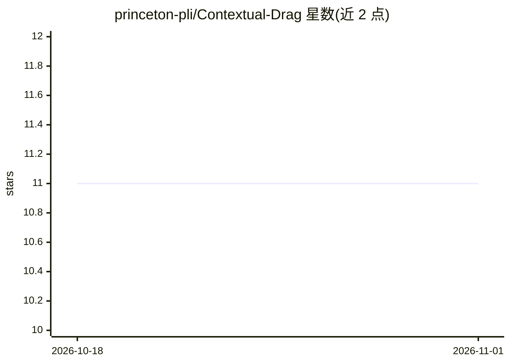

# princeton-pli/Contextual-Drag

⭐ 11 · Python · Apache-2.0 · 推送 2026-03-05 · [GitHub](https://github.com/princeton-pli/Contextual-Drag) · 组织维护

**研究 LLM 上下文中错误尝试如何拖累后续推理的评测代码库**

论文《Contextual Drag: How Errors in the Context Affect LLM Reasoning》的配套代码：构造含失败/成功尝试的上下文数据集（2F/2T/1F/1T），在 8 个推理任务上评测 11 个模型的性能变化（10-20% 下降），并用树编辑距离分析错误的结构性继承；另含错误信号条件化分析、上下文去噪与 fallback 行为 SFT 微调两类缓解实验。推理基于 vLLM 运行，通过 pip 安装依赖后按 shell 脚本分步复现。

## 筛选速览

| 维度 | 判定 | 备注 |
|---|---|---|
| AI 角色 | `ai-ecosystem` | LLM/agent 周边工具 |
| 许可风险 | `permissive` | Apache-2.0 |
| 部署形态 | `library` | 以包/库形式分发 |
| 模型依赖 | local-ok | 支持本地模型 |
| 硬件要求 | — | 无带数字的原话,不猜 |
| 安装摩擦 | `low` | 无编译、无系统依赖或容器化 |
| 成熟度 | — | 结构信号不足 |

## 能力要点

- 生成 2F/2T 上下文数据集并跨多模型多任务评测 contextual drag 效应
- 树编辑距离（TED）分析后续推理对上下文错误结构的继承
- 错误信号条件化实验：检验外部提示或自我检测错误能否缓解
- 两类缓解方案：上下文去噪与 fallback 行为 SFT 微调

## 适用场景

- 复现论文的 contextual drag 评测与主表结果
- 分析自我改进/自反思流程中失败尝试带来的性能退化
- 在自有模型上测试上下文错误对推理的影响并尝试缓解

## 场景标签

`模型评测` · 领域:评测与运维

## 证据(README 行号)

> L7: Central to many self-improvement pipelines for large language models (LLMs) is the assumption that models can improv
> L9: Across evaluations of 11 proprietary and open-weight models on 8 reasoning tasks, contextual drag induces 10-20% per
> L51: Once the datasets are generated, run the main evaluations to measure how these contexts "drag" the model's performa

## 星数曲线

2026-10-18 11 → 2026-11-01 11（+0）

---
*卡片 v1 · prompt 1.4 · 生成 2026-11-01 · 置信度 high · 依据 README sha `ae32ca45a424` · [字段定义](../../DATASET.md)*
