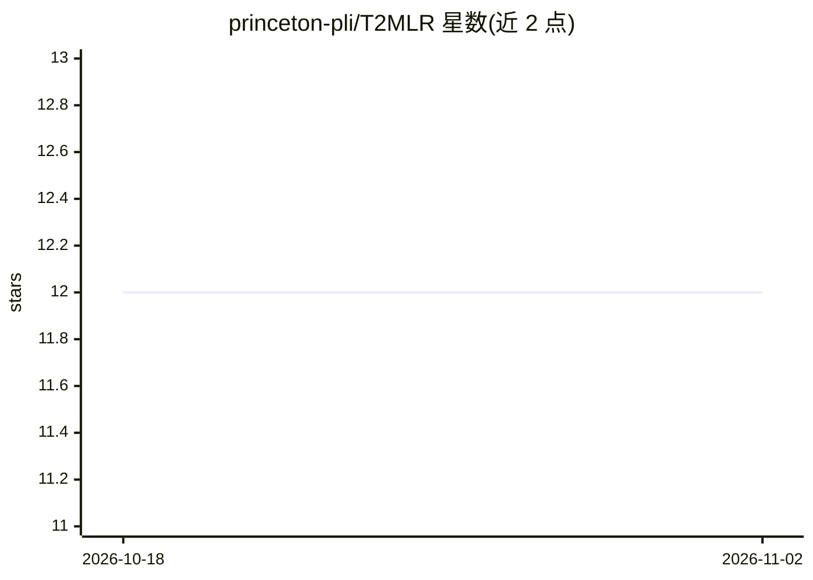

# princeton-pli/T2MLR

⭐ 12 · Python · Apache-2.0 · 推送 2026-09-08 · [GitHub](https://github.com/princeton-pli/T2MLR) · 组织维护

**T2MLR 论文官方实现：Transformer 中层时序循环训练代码库**

论文《T2MLR: Transformer with Temporal Middle-Layer Recurrence》的官方训练代码。核心为 T2MLRWrapper，包装 Hugging Face 因果语言模型，将前一 token 深层中间表示经门控循环通路注入当前 token 的浅层，支持常规前向、批近似循环（Jacobi 并行）、精确序列循环与缓存单步循环四种执行路径。附 S5 检索、FineWeb 预训练、GSM8K、路径寻找、ProsQA、变量赋值、FTP 七类任务的训练脚本与数据生成器。面向复现与扩展该架构的研究者，本发布为精简版，不含内部日志与完整测试套件。

## 筛选速览

| 维度 | 判定 | 备注 |
|---|---|---|
| AI 角色 | `ai-native` | 本体是模型或模型工具 |
| 许可风险 | `permissive` | Apache-2.0 |
| 部署形态 | `library` | 以包/库形式分发 |
| 模型依赖 | — | README 未给出锁定关系 |
| 硬件要求 | — | 无带数字的原话,不猜 |
| 安装摩擦 | `low` | 无编译、无系统依赖或容器化 |
| 成熟度 | — | 结构信号不足 |

## 能力要点

- T2MLRWrapper 封装 HuggingFace 因果语言模型并注入中层循环通路
- 四种前向路径：常规/批近似/精确序列/缓存单步循环
- 覆盖 7 类任务（S5 检索、FineWeb、GSM8K 等）的训练脚本与 sweep 配置
- 提供 pathfinding/变量赋值/S5 检索的合成数据集生成脚本

## 适用场景

- 复现论文中的预训练与多跳推理微调实验
- 在参数量与推理算力匹配的设定下研究中层循环机制
- 基于 wrapper 扩展自定义循环混合模块（gate zoo）

## 场景标签

`模型训练` `微调` · 领域:训练与推理

## 证据(README 行号)

> L7: We introduce Transformers with Temporal Middle-Layer Recurrence (T2MLR), a generalized Transformer architecture that
> L13: This repository is the release version of the T2MLR training codebase used in the paper. It contains the core T2MLR

## 星数曲线

2026-10-18 12 → 2026-11-02 12（+0）

---
*卡片 v1 · prompt 1.4 · 生成 2026-11-01 · 置信度 mid · 依据 README sha `1dcbfb048928` · [字段定义](../../DATASET.md)*
